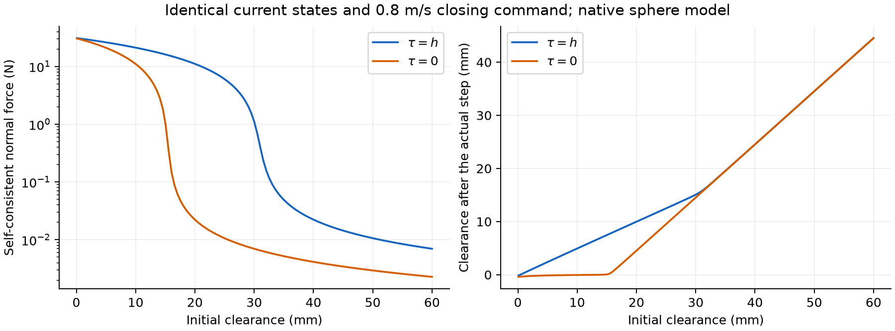
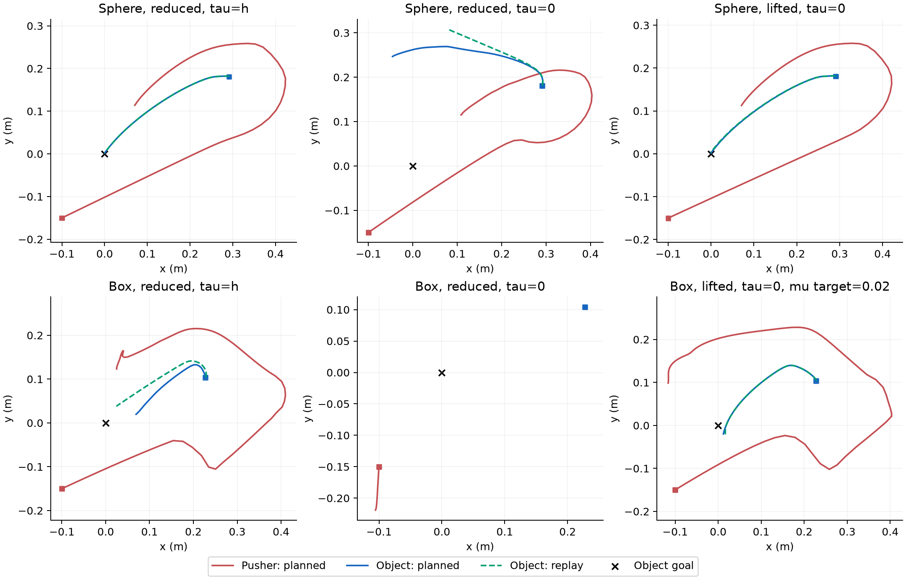
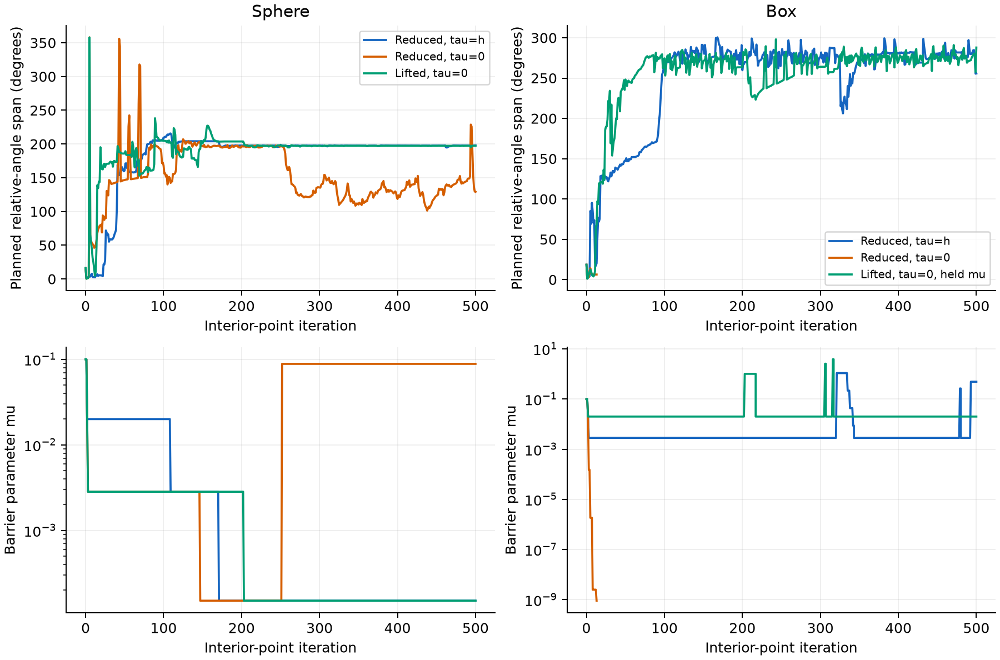

**Why the extra prediction time changes contact discovery**

Setting `tau=0` removes more than an incidental term from the smoothed contact law. With `next_step=True`, the default law evaluates penetration using `-phi0 - 2*dt*vn`, although positions advance by one timestep. It therefore produces substantial repulsive forces during approach while the bodies still have clearance after that step. Setting `tau=0` delays this response until approximately the actual next contact configuration. The reciprocal tail still attracts the finite-barrier optimization toward contact in both cases, but the approach trajectories, useful force magnitudes, and ensuing geometric steering differ substantially.

The experiments reproduce the reported failure particularly clearly in **regular multiple shooting with predicted-force positivity inequalities**. The sphere loses its useful route with `tau=0`; the box converges to a no-push solution in 13 IPOPT iterations. However, `2*dt*vn` is not universally necessary: lifted shooting with consistent `tau=0` finds the sphere's far side with both IPOPT and IPPAS. A subsequent reduced-form `tau=0` continuation reaches full NLP convergence. The supported conclusion is that the extra prediction time strongly changes discovery and the solver's basin of attraction, rather than creating the only possible contact-seeking derivative.

This follow-up uses revision `0d71f5f3e96b3d3168bcfb7fb8664f3325afa9a6`, the `mujodico` environment, CPU/x64, seed 0, and the original sphere and box objectives, actuator bounds, and linear-interpolation initialization. There are 26 saved optimization runs, including controls that separate prediction time from smoothing width, two solvers, two transcriptions, barrier-target changes, two continuation runs, and one deliberately inconsistent derivative diagnostic. Unless identified otherwise, the iteration budget is 500 and contact smoothing is `2e-5`. All modifications are process-local in [run.py](run.py); production contact and transcription code is unchanged. Complete measurements are in [results.csv](results.csv), with every run's arguments, status, residuals, and histories in [data](data/).

**The controlled change matches the clarification `tau=0`.** The relevant implementation is [hunt_crossley_normal_impulse](/home/wei-chen/mujodico/mujodico/mjx/_src/solver_sap_util.py:102), together with [its manually supplied velocity derivative](/home/wei-chen/mujodico/mujodico/mjx/_src/solver_sap_util.py:125). For positive smoothing, write

$$
h=dt,\qquad a=1+\tau/h,\qquad
F_{a,b}(\phi,v)=K d\,r_{\epsilon_b}(-\phi-a h v)\,s(1/d-v),
\qquad \epsilon_b^2=\frac{4\kappa b}{K}.
$$

Here `F` is force, while the function returns impulse `hF`; `r` is the reciprocal penetration ReLU and `s` the local velocity ReLU. The default law has `a=b=2`. Setting `tau=0` consistently in both helpers gives `a=b=1`. Thus the change also reduces `epsilon` by `sqrt(2)` and halves the distant force tail. To separate these effects, the width-matched control uses `a=1,b=2` in both helpers. The force-value and derivative coefficients agree in every main experiment.

Both tasks have `condim=1`. These tests exercise the next-step normal law; they do not establish identical results for elliptic friction or a frictional law that also evaluates `next_step=False`. At zero smoothing, replays restore the original one-step hard law in every experiment.

**Static attraction survives removal of the extra timestep.** In the reciprocal branch, let `g=phi+a*h*v`. Where the velocity ReLU is linear,

$$
F_{a,b}=\frac{\kappa b(1-dv)}{\phi+a h v+\epsilon_b}.
$$

Consequently, on the force-consistency manifold, the predicted-force positivity barrier is

$$
B_{a,b}=-\mu\log F_{a,b}
=\mu\log(\phi+a h v+\epsilon_b)
-\mu\log(1-dv)-\mu\log(\kappa b).
$$

Its partial derivatives, holding the constitutive velocity argument independent, are

$$
\frac{\partial B}{\partial\phi}
=\frac{\mu}{\phi+a h v+\epsilon_b},\qquad
\frac{\partial B}{\partial v}
=\frac{\mu a h}{\phi+a h v+\epsilon_b}
+\frac{\mu d}{1-dv}.
$$

At rest, reducing `a` from 2 to 1 leaves the gap derivative unchanged if `b` is held fixed. With the native width change it differs only through the small epsilon. The force changes by a factor of about two; its logarithmic gap derivative barely changes. Therefore neither losing the algebraic tail nor losing the static radial barrier gradient explains the observed failure.

The native sphere parameters at its initial configuration are `h=0.02 s`, `K=69252.08 N/m`, `d=5.26316 s/m`, and `kappa=2e-5`. The two penetration widths are 48.07 and 33.99 micrometers. The following scalar measurements use the constitutive law at fixed `v=0`, initial clearance 382.317 mm:

| Law | Force | `d log F / d phi` | `d log F / d v` |
|---|---:|---:|---:|
| Default, `a=2,b=2` | `1.04612e-4 N` | `-2.615301 /m` | `-5.367770 s/m` |
| `tau=0`, `a=1,b=1` | `5.23079e-5 N` | `-2.615397 /m` | `-5.315466 s/m` |
| `tau=0`, width matched, `a=1,b=2` | `1.04612e-4 N` | `-2.615301 /m` | `-5.315464 s/m` |

These are partial derivatives of the scalar law, not the complete derivatives through the implicit forward solve. The latter were checked separately against finite differences. At the distant stationary point even the scalar velocity log-gradient changes by only about 1%; the additional effect becomes much larger during approach.

**The important difference appears when the pusher is closing on the object.** With a frozen contact normal and semi-implicit position update,

$$
\phi_{next}\simeq\phi+h v^+.
$$

This first-order next-gap relation is also the convention described in [Drake's discrete-contact documentation](https://drake.mit.edu/doxygen_cxx/group__hydro__margin.html). In this repository the extra `tau` changes the penetration argument to

$$
-\phi-(h+\tau)v^+\simeq-\phi_{next}-\tau v^+.
$$

For a closing velocity `v+<0`, `tau=h` adds a positive penetration amount `h*abs(v+)`. Ignoring the small smooth transition, the default law enters its linear penetration branch near `phi=2*h*abs(v+)`, whereas `tau=0` enters near `phi=h*abs(v+)`. The band between these boundaries can carry substantial force in the default law while remaining in the small reciprocal tail in the one-step law. At `h=0.02 s` and a closing speed near `0.8 m/s`, this difference spans roughly 16 mm, much larger than the approximately 0.05 mm penetration smoothing width.

The force cannot be established by plugging a fixed velocity into the law alone, because repulsion changes the solved next velocity. [probe.py](probe.py) therefore compares **self-consistent forward solves** from identical states and identical controls. Only the law changes. The sphere starts at the stated clearance, the pusher's current velocity and velocity command point toward the stationary object with the stated magnitude, and the inner solves use 100 iterations and `1e-12` tolerances.

| Initial clearance and pusher speed | Force, `tau=h` | Force, `tau=0` | Force, `tau=0`, width matched | Actual next clearance, `tau=h` / `tau=0` |
|---|---:|---:|---:|---:|
| 3 mm, 0.1 m/s | 0.89811 N | 0.02709 N | 0.05278 N | 1.507 / 1.078 mm |
| 10 mm, 0.2 m/s | 0.03443 N | 0.00654 N | 0.01305 N | 6.146 / 6.132 mm |
| 30 mm, 0.8 m/s | 1.11316 N | 0.00697 N | 0.01393 N | 15.065 / 14.520 mm |

At 30 mm, the force ratio is approximately **160**, or **80** after matching the smoothing width. At 3 mm it is approximately 33, or 17 with matching width. This difference cannot be attributed just to the factor-of-two distant tail amplitude. The complete predicted-force Jacobians agree with centered finite differences to relative errors below `4e-9` at these approaching states. Detailed values and curves are in [probes.json](probes.json).



The effect also has a useful stiff-contact interpretation. For one frozen-normal contact, write the scalar momentum balance as

$$
v^+=v_{free}+c F,\qquad c>0.
$$

In the large-stiffness, active-contact limit, the law approximately pins `phi+a*h*v+` to zero. Thus

$$
v^+\simeq-\frac{\phi}{a h},\qquad
F\simeq\left[\frac{-\phi/(a h)-v_{free}}{c}\right]_+,\qquad
\phi_{next}\simeq\left(1-\frac1a\right)\phi.
$$

The one-step law brings the next pose approximately to contact. The default law can support force while leaving approximately half the initial clearance. This is an anticipatory contact response, not an actual integration step of length `2h`. The finite-stiffness measurements above check the relevant effect without assuming this limit.

There is an associated increase in effective contact damping. In the unsmoothed linear penetration branch, with `delta=-phi`,

$$
F=K(\delta-a h v)(1-dv)
=K\delta-K(a h+d\delta)v+K a h d v^2.
$$

Changing `a=1` to `a=2` adds `K*h` to the linear velocity coefficient. In the scalar implicit balance, derivatives of the force are divided by `1-c*F_v`, so this additional velocity dependence also changes conditioning and sensitivity. Anticipatory activation and extra damping are coupled consequences of the same term; the present experiments do not assign separate percentages of the route-discovery improvement to them.

**This force availability connects the contact law to sideways discovery.** The lifted transcription implements

$$
x_{k+1}=f_2(x_k,u_k,\lambda_k),\qquad
\lambda_k=F_{a,b}(x_k,u_k),\qquad \lambda_k\geq0.
$$

The integration function `f2` uses specified forces; the forward constitutive predictor enters the equality separately. See [the transcription](/home/wei-chen/mujodico/mujodico/trajopt/_src/transcriptions.py:111). Changing `tau` changes the force predictor and its derivatives. It does **not** change `f2` at a fixed state, actuator input, and specified force. The probes assert exact equality of both `f2` and its state Jacobian across all four tested law/derivative configurations at the same specified force.

For the sphere, a force `lambda*n`, with `n=(object-pusher)/r`, has the geometric derivative

$$
\frac{\partial(\lambda n)}{\partial p}
=-\frac{\lambda}{r}(I-nn^T)
$$

when the object and force magnitude are held fixed. This rotates the applied force through lateral pusher motion. The earlier [route-discovery ablation](../contact_route_discovery/REPORT.md) verified that suppressing this derivative path prevents the useful route in the tested sphere runs. The box has an analogous task-weighted moment-arm derivative before a flat-face normal itself changes direction.

The extra prediction time does not introduce these geometric derivatives. It lets a stronger positive force become compatible with approaching configurations that still have clearance, so those existing derivative paths can have a much larger effect. From the near side, increasing normal force sends the object away from its goal. Reducing the cost while maintaining a useful positive force favors rotating its direction, which sends the pusher sideways and eventually to the far side. The barrier supplies the pressure to retain force; the task cost and geometric derivatives supply the directional preference.

In the reduced formulation `lambda=F(x,u)` is substituted out at every evaluation, so there is no independent force available when `F` is tiny. Lifted iterates can carry temporarily inconsistent positive forces and retain geometric steering before constitutive consistency is restored. This supplies a concrete reason that changing prediction time can be much more damaging in reduced shooting. It does not guarantee that every lifted run will find the route.

**Solver experiments show both the reported effect and its limits.** “Reduced” below means ordinary multiple shooting formed by substituting the predictor into the lifted integration function and keeping `F(x,u)>=0` as a stage inequality. It is the predicted-force positivity problem, with no independent force variables. All rows below start from the original linear interpolation. “Replay” integrates the saved actuator controls from the actual initial state using the same smoothed contact law; it does not use the optimized state samples.

| Task / solver / transcription | `tau` and width | Planned object error | Smoothed replay error | Termination |
|---|---|---:|---:|---|
| Sphere / IPOPT / reduced | `h`, native | 2.49 mm | 2.50 mm | 500 iterations |
| Sphere / IPOPT / reduced | `0`, native | 250.83 mm | 318.39 mm | 500 iterations, infeasible |
| Sphere / IPOPT / reduced | `0`, width matched | 342.77 mm | 342.77 mm | Converged, no push, 267 iterations |
| Sphere / IPPAS / reduced | `h`, native | 2.44 mm | 5.11 mm | 500 iterations |
| Sphere / IPPAS / reduced | `0`, native | 342.76 mm | 342.76 mm | Converged, no push, 118 iterations |
| Box / IPOPT / reduced | `h`, native | 72.07 mm | 45.04 mm | 500 iterations, infeasible |
| Box / IPOPT / reduced | `0`, native | 250.04 mm | 250.04 mm | Converged, no push, 13 iterations |
| Box / IPOPT / reduced | `0`, width matched | 16.24 mm | 37.54 mm | 500 iterations, infeasible |
| Sphere / IPOPT / lifted | `h`, native | 2.48 mm | 2.65 mm | 500 iterations |
| Sphere / IPOPT / lifted | `0`, native | 2.41 mm | 3.08 mm | 500 iterations |
| Sphere / IPPAS / lifted | `0`, native | 2.41 mm | 6.03 mm | Line-search failure, 494 iterations |
| Box / IPPAS / lifted | `h`, native | 16.71 mm | 22.36 mm | 500 iterations |
| Box / IPPAS / lifted | `0`, native | 107.94 mm | 256.60 mm | 500 iterations, infeasible |

The reduced sphere and box failures support the observation. The lifted sphere results refute a universal requirement for `2h` and distinguish loss of successful exploration from loss of all radial attraction. The reduced IPOPT sphere with native `tau=0` moves substantially, but fails to retain a useful feasible push; its failure is not complete immobility. The reduced box no-push solution has raw maximum constraint violation `1.04e-15` and IPOPT dual infeasibility `1.30e-9`: this particular failure is convergence to a bad local solution, rather than failure of the NLP convergence checks.

Matching width is deliberately not presented as a universal fix. It recovers substantial box motion even with `tau=0`, while the reduced sphere converges to no push. In lifted IPOPT sphere shooting the width-matched run finishes at 119.55 mm planned error and still has 114.68 mm error after 1000 iterations, although native-width `tau=0` succeeds. Even a small change in the tail and its transition can alter the nonconvex solver path.



**Barrier scheduling and the numerical formulation also matter.** Holding IPOPT's target barrier at `mu=0.02` with native-width `tau=0` changes the lifted box result from 277.10 mm planned / 229.37 mm replay error to 23.27 mm planned / 26.72 mm replay error. The actual replay's relative pusher–object angular span is 282.90 degrees. This run uses the original interpolation and objective. It remains unconverged at 500 iterations, so it establishes useful route recovery rather than an accurate KKT solution.

Holding the same positive barrier is not sufficient for reduced sphere shooting: that control ends with 151.01 mm planned and 222.96 mm replay error. A finite barrier helps exploration, but cannot by itself guarantee the right contact sequence or cure the numerical difficulties.

The held-barrier lifted sphere reaches IPOPT's acceptable termination at `mu=0.02`, with 15.61 mm replay error. This is a solution of the positive-barrier target problem, not convergence to zero complementarity for the original NLP. IPOPT explicitly documents that distinction for [mu_target](https://www.coin-or.org/Ipopt/OPTIONS.html#OPT_mu_target).



Lifting and elimination give the same feasible dynamics and, after substitution, the same formal force barrier. They need not produce the same sequence of numerical steps. The default “Gauss–Newton” implementation omits constraint curvature from the Lagrangian Hessian; see [StagewiseNLPModel](/home/wei-chen/mujodico/mujodico/trajopt/_src/stagewise_nlp_model.py:343). Omitting curvature before or after eliminating nonlinear force variables is not invariant under that elimination. The two formulations also begin with different force/slack consistency, and the finite-accuracy contact predictor adds another source of error. These code facts and the observed sensitivity support a numerical-basin explanation. They do not identify one accepted line-search step or one Hessian eigenvector as the sole cause of every failed run.

**A converged one-step solution demonstrates that motion remains representable.** The experiment `sphere_reduced_a1_warm` starts from the saved reduced `tau=h` trajectory, changes to `tau=0`, uses full Lagrangian curvature, and tightens both inner contact tolerances to `1e-12` with 100-iteration caps. No guiding objective is added. It converges in 234 IPOPT iterations:

| Quantity | Value |
|---|---:|
| Planned final object error | 2.92873 mm |
| Same-law smoothed replay error | 2.92873 mm |
| Original zero-smoothing replay error | 4.39449 mm |
| Planned/replayed relative angular span | 196.925 degrees |
| Raw maximum dynamics defect | `1.69e-10` |
| Final IPOPT primal infeasibility | `1.73e-9` |
| Final IPOPT dual infeasibility | `1.74e-9` |
| Final barrier parameter | `2.51e-9` |

This is a continuation result, not evidence that full curvature alone discovers the same route from the original interpolation with `tau=0`. Conversely, the lifted box continuation with default curvature and default inner accuracy fails to finish accurately. Continuation is useful only when paired with adequate local optimization accuracy.

**Prediction-time regularization has a distinct modeling shortcoming.** In production code, `tau=h` for every positive smoothing value but `tau=0` at exactly zero. Ignoring the velocity cutoff for compactness,

$$
\lim_{\kappa\downarrow0}F_\kappa(\phi,v)
=K[-\phi-2hv]_+(1-dv)_+,
\qquad
F_0(\phi,v)=K[-\phi-hv]_+(1-dv)_+.
$$

Thus decreasing smoothing toward zero does not continuously recover the implementation's zero-smoothing dynamics. There is a prediction-time jump at zero. The extra `K*h` velocity coefficient likewise does not disappear as positive smoothing decreases. This explains why “only a tiny smoothing parameter” can still correspond to a meaningfully different discrete contact model.

For example, the lifted IPOPT sphere's default `tau=h` controls replay with 2.65 mm error in their own smoothed model, but 22.50 mm in the original zero-smoothing model. The native `tau=0` controls replay at 3.08 and 3.48 mm respectively. These numbers include remaining optimization errors and are not a pure measurement of model mismatch, but the discontinuous limiting laws can be established independently of those errors.

A practical implication is to separate prediction time from smoothing in future implementations and continuation schedules. The tested sphere continuation uses `tau=h` to discover a route, then removes the additional prediction time and finishes with accurate derivatives and constraint curvature. Sending `kappa` toward zero while leaving the current `tau` switch untouched cannot accomplish the same model continuation. This is a supported strategy for this sphere example, not a demonstrated universal remedy for the box or frictional regrasp tasks.

**The manual derivative remains an independent implementation check.** A separate diagnostic deliberately changes the value to one-step prediction while leaving its manual derivative at two-step prediction. At fixed `phi=3 mm`, `v=-0.1 m/s`, and matched width, the actual impulse derivative is about `-0.02625`, while the mismatched helper supplies `-91.8501`. The helper enters both the inner Newton system and the implicit differentiation machinery; this is not merely an outer optimizer Hessian choice. That diagnostic develops very large infeasibility and replays with 342.79 mm error despite a superficially better planned endpoint. It is excluded from the physical comparisons above. Your clarified `tau=0` observation is analyzed using consistent helpers, so a derivative mismatch is not needed to explain the effect.

**Reproduction and saved evidence.** From the repository root, use the `mujodico` environment with x64 enabled. Representative commands are:

```bash
conda activate mujodico
export JAX_ENABLE_X64=True

# Lifted comparisons: tau=h versus consistent tau=0.
python reports/contact_prediction_time/run.py --label sphere_a2 --alpha 2
python reports/contact_prediction_time/run.py --label sphere_a1 --alpha 1

# Substitute out forces, retain predicted-force nonnegativity.
python reports/contact_prediction_time/run.py --label sphere_reduced_a2 --form reduced --alpha 2
python reports/contact_prediction_time/run.py --label sphere_reduced_a1 --form reduced --alpha 1
python reports/contact_prediction_time/run.py --label sphere_reduced_a1_width2 --form reduced --alpha 1 --width-alpha 2
python reports/contact_prediction_time/run.py --label box_reduced_a1 --task PushBox2d --form reduced --alpha 1

# IPPAS reduced comparison.
python reports/contact_prediction_time/run.py --label sphere_reduced_ippas_a2 --form reduced --solver ippas --alpha 2
python reports/contact_prediction_time/run.py --label sphere_reduced_ippas_a1 --form reduced --solver ippas --alpha 1

# Finish the already discovered reduced route under tau=0.
python reports/contact_prediction_time/run.py --label sphere_reduced_a1_warm --form reduced --alpha 1 --init sphere_reduced_a2 --hessian full --inner-tolerance 1e-12 --iterations 300

# Constitutive-law, finite-difference, given-force invariance, and curve probes.
python reports/contact_prediction_time/probe.py
python reports/contact_prediction_time/analyze.py
```

All other settings are recorded in the individual JSON files. The saved runs used a shared compilation cache in `/tmp`, and single-thread BLAS/CPU settings for concurrent experiments; these are mechanism comparisons, not timing benchmarks. The sphere and box have different horizons and timesteps, and raw residuals mix state-continuity units with newtons, so those raw maxima should not be compared as dimensionless accuracy scores. Intermediate planned angle spans, especially around restoration or infeasible states, are not proofs of executable route discovery. The replay columns and explicitly converged results provide the relevant checks.
