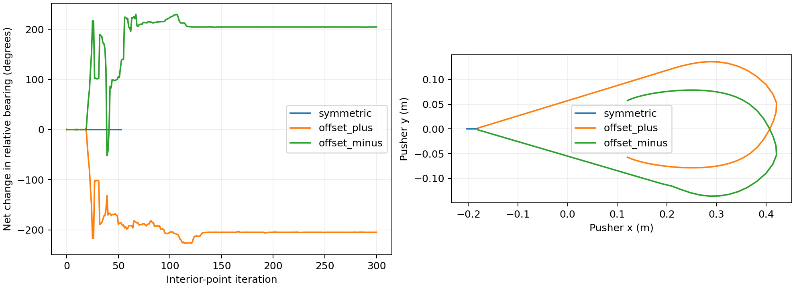
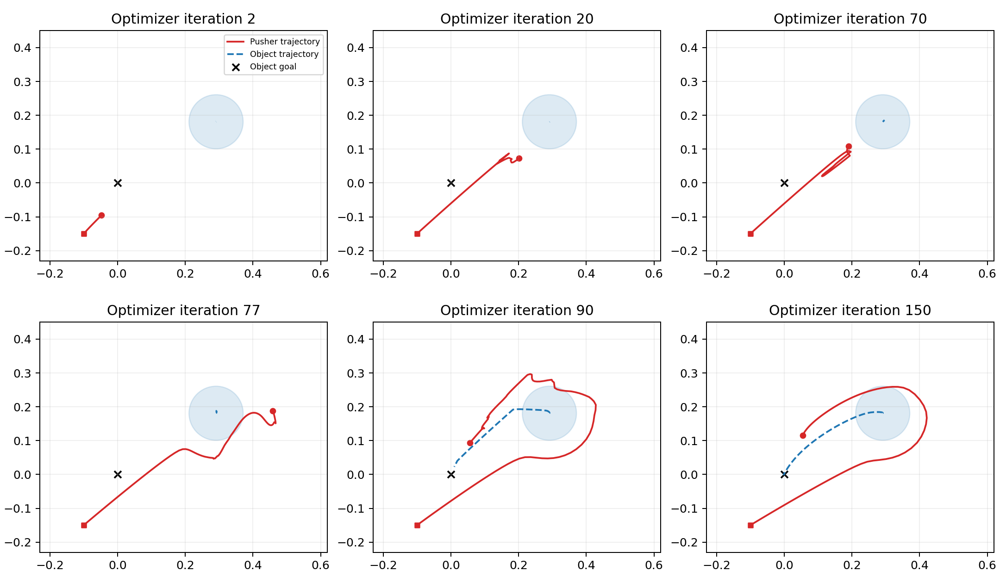
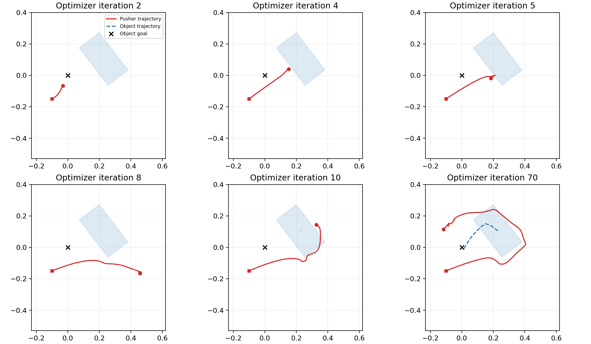
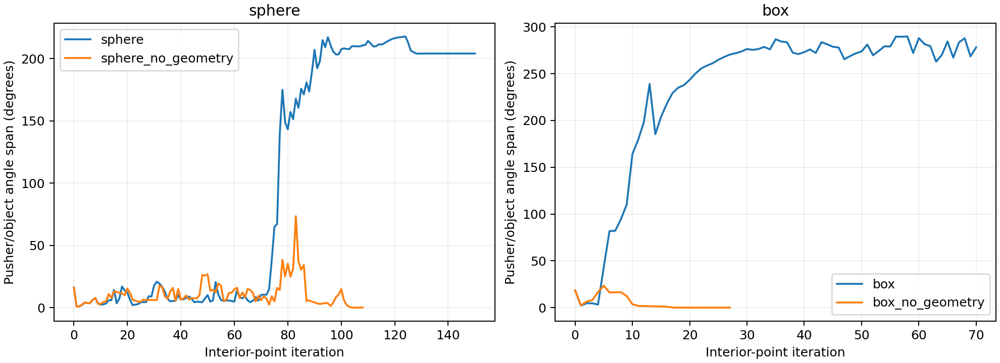

**What makes the optimizer move sideways and discover the far side?**

Follow-up investigation, 16 November 2026. Nine new IPOPT experiments trace the original PushSphere2d and PushBox2d lifted problems, selectively remove geometric derivative paths, and test an exactly symmetric sphere initialization and two small perturbations. Production solver and task files are unchanged. All runs use CPU/x64 and the original task costs, horizons, and control bounds. Actual contact smoothing is `2e-5`, matching the lifted examples.

**The missing mechanism is the task-weighted geometry of a positive contact force.** The force barrier supplies an incentive to approach and maintains positive force/slack during the search. The dynamics Jacobian says what a sideways displacement would do to the *direction* or *moment* of that force. Equality multipliers propagate the object objective through the horizon and determine whether those changes are favorable. The resulting lateral search signal is different from a preference for small signed distance.

For a sphere, sideways motion rotates the normal force. For the box's initial flat-face contact, sideways motion initially changes torque without changing the normal force direction. Both produce a reason to move sideways before a useful direct push is available. The detailed mechanisms are consequently related, but not identical.

**A sphere supplies a first-order force-steering derivative whenever its force is positive.** Let `p` be pusher position, `o` object position, `r=||o-p||`, `n=(o-p)/r`, and `λ` the scalar normal force acting on the object. The force is

$$f_o=\lambda n.$$

For a sideways displacement `δp` with `nᵀδp=0`, holding `o` and `λ` fixed,

$$\delta f_o=-\frac{\lambda}{r}\,\delta p,\qquad
\frac{\partial f_o}{\partial p}=-\frac{\lambda}{r}(I-nn^T).$$

This rotates a repulsive force; it does not introduce adhesion or a direct tangential contact force. The contact remains frictionless. Changes in object velocity and next position follow through the integration step. The equal and opposite reaction on the pusher also enters the coupled trajectory problem.

At `λ=0` this derivative vanishes. At a positive interior iterate it is nonzero even for a separated candidate contact. Initially IPOPT pushes the lifted forces to approximately `0.01` N, while the actual forward constitutive force at the initial sphere state is only about `0.0001046` N. Later the forces, contact distance, multipliers, and control trajectory change together. A hard-contact rollout at a separated zero-force trajectory would not have this search direction.

The useful derivative is in the **first derivative of the dynamics constraints**. It remains present when `gauss_newton=True` omits constraint contributions to the Hessian. Discovering the route therefore does not require the solver to use the full second derivative of the contact normal. At exactly zero force, a simultaneous change of force and normal would instead first appear through a mixed, second-order term; maintaining positive force makes the normal variation visible in a first-order linearization.

Independent [geometric probes](geometric_probes.json) verify the distinction numerically. At the initial sphere state, a unit tangential displacement has **zero gap derivative** but a nonzero object-force-direction derivative `(1.260858,-1.490038)` per unit normal force. At the initial box state, the same construction has essentially zero gap and translational-force derivatives, but angular generalized-force derivative **−1** per unit normal force. Central differences agree with these derivatives within `1.1e-11` and `5.1e-12`, respectively.

The geometry term also survives eliminating the lifted forces. For the reduced formulation `f(x,u)=f₂(x,u,Fκ(x,u))`, the chain rule gives

$$D_p f=(D_p f_2)_{\lambda\;\mathrm{fixed}}+(D_\lambda f_2)D_pF_\kappa.$$

The first term is precisely the force-direction/moment-arm contribution discussed here. Thus independent force variables are not mathematically required to retain this information. The new derivative-path ablations specifically test the lifted implementation; the earlier reduced-force-barrier runs supply the separate empirical evidence that ordinary multiple shooting can also discover the route.

**Moving sideways improves the direction of an unavoidable positive push before it makes pushing toward the goal possible.** A local illustrative model is

$$J(\theta,\lambda)=\|e+\beta\lambda n(\theta)\|^2-\mu\log\lambda,$$

where `e=o-o_goal`, `β>0` is an effective force-to-displacement coefficient, and `θ` is the angle between `e` and the contact normal. Expanding the object-cost part gives

$$J=\|e\|^2+2\beta\lambda\|e\|\cos\theta+\beta^2\lambda^2-\mu\log\lambda,$$

and

$$\frac{\partial J}{\partial\theta}=-2\beta\lambda\|e\|\sin\theta.$$

On the near side, the normal points roughly along `e`: pushing increases object error. Rotating that force away from the worst direction reduces its harmful component. It does not have to point toward the goal immediately. Continuing this rotation eventually makes the goal-directed component favorable on the far side.

The barrier opposes simply reducing `λ` to zero. With an unfavorable force direction, minimizing over `λ` in this toy model gives a small positive force; changing the angle still reduces the object's force-induced cost. Once the angle becomes favorable, a larger force becomes useful. This explains a plausible sequence of approaching, suppressing an unfavorable push, moving laterally, and then increasing the useful push.

The toy model isolates the directional incentive. It does not prove that the complete trajectory NLP has a saddle at the near-side configuration: control effort, the fixed initial state, dynamics, force equalities, bounds, and the remaining trajectory all affect its curvature and local minima. The actual solver solves a coupled KKT system; it does not apply independent gradient descent to this two-variable model.

**The seed-0 sphere already breaks the angular symmetry.** The initial normal is about **8.373°** from the object's error direction. Thus the directional object-cost term has a nonzero first-order angular slope. Its sign selects a side. The barrier alone is radial at a resting sphere configuration and does not determine this side.

This was tested by replacing only the sphere problem's initial planar positions with `p=(-0.18,0)` and `o=(0.3,0)`, retaining the original linear interpolation and cost. The entire setup is reflection-symmetric about the x axis. The ordinary default Hessian approximation preserves that symmetry in these runs:

| Initial pusher y | Net pusher/object bearing change | Planned final object error | Route outcome |
|---:|---:|---:|---|
| 0 | 0° | 300.04 mm | No sideways discovery; solver success at a no-push solution |
| +2 mm | −204.64° | 2.226 mm | Clockwise route; 300-iteration limit |
| −2 mm | +204.81° | 2.227 mm | Counterclockwise route; 300-iteration limit |

Both perturbed runs exceed a 90° bearing span at iteration 22. Their later histories are not exact reflected copies: floating-point sensitivity and different accepted iterates lead to different subsequent candidate paths. This is evidence for deterministic symmetry breaking from geometry, not a random exploration procedure or a guarantee of escape from a symmetric start. The symmetric result also shows why a radial contact attraction by itself is an incomplete explanation.



**The full-horizon optimization obtains this preference through the dynamics multipliers.** Write the local equality as

$$c_k=\begin{bmatrix}x_{k+1}-f_2(x_k,u_k,\lambda_k)\\\lambda_k-F_\kappa(x_k,u_k)\end{bmatrix}=0.$$

Let `ν_k` be the dynamics multiplier and `η_k` the force-equality multiplier. The pusher-position derivative of the Lagrangian includes

$$-\left(\frac{\partial f_2}{\partial p_k}\right)^T\nu_k
-\left(\frac{\partial F_\kappa}{\partial p_k}\right)^T\eta_k.$$

The first expression contains force-direction and force-moment geometry. The second contains the constitutive-law sensitivity, including gap and velocity effects. Costates/multipliers connect these local changes to running and terminal object costs over the rest of the horizon. There is no direct pusher-position cost in either original task.

For diagnostics, I isolate the geometric part by differentiating

$$f_2(x,u,\lambda)-f_2(x,u,0),$$

so that the pusher's identity position propagation is not mistakenly counted as force geometry. I then contract this Jacobian with the actual dynamics multipliers at each saved iterate. Multipliers at infeasible iterates need not equal costates of a physically realizable rollout; they describe the solver's current local trajectory model.

The trace gives concrete lateral signals. Define `t=R90(n)` and measure derivatives along `t`. Positive derivative means decreasing this Lagrangian contribution favors displacement along `-t`.

| Sphere iterate / stage | Lifted force | Gap | Geometric lateral Lagrangian contribution | Force-equality lateral contribution |
|---|---:|---:|---:|---:|
| 10 / 49 | 0.00422 N | 251.9 mm | +0.00047 | approximately zero |
| 40 / 28 | 0.04478 N | 1.6 mm | +0.01645 | +0.00005 |
| 80 / 27 | 0.11602 N | 36.2 mm | +0.26340 | approximately zero |

At iteration 80/stage 27, the next accepted pusher displacement along `t` is **−2.86 mm**, agreeing with that geometric descent direction. At iteration 40 it is not: the whole KKT step balances many constraints and objective terms. The individual contribution is a mechanism and a measured part of the step equations, not a stand-alone formula that predicts every accepted displacement.

Stage 0 can have a nonzero local geometric derivative while its displacement is exactly zero, because the initial-state equality fixes it. The optimizer must realize useful changes through later states and controls. This is another reason to distinguish a local force derivative from the complete solution step.

**The observed sphere sequence is not a monotone angular march.** In the new baseline trace, the pusher initially approaches the near side while final object error stays near its original **343 mm**. The bearing span fluctuates at small angles through much of the early solve. Around iteration 75 the candidate trajectory starts to travel appreciably around the object; it exceeds 90° at iteration 77. By iteration 90 the planned error is **24.8 mm**, and at iteration 150 it is **3.21 mm** with about a 204° bearing span.

The growing positive force and decreasing radial distance make the geometric sensitivity, which scales as `λ/r`, more consequential. Multiplier updates and the horizon's coupled equations determine when that incentive overcomes the current near-side trajectory. The exact iteration of the transition is sensitive to solver details. The earlier saved 500-iteration run finds a similar route but different later iterates.

The lateral transition is not triggered by a new barrier parameter in this trace: `μ` stays at **0.02 from iteration 2 through iteration 90**, spanning the near-side dwell, lateral escape, and start of useful pushing. The force-equality/dynamics residuals remain large during parts of that transition; the raw primal defect at iteration 77 is about **36.6**. Changes in geometry, multipliers, and accepted infeasible steps matter even while `μ` is fixed. The constitutive-law contribution can also be important at other stages, especially at corners or nonzero contact velocity; it is not purely radial throughout the trajectory.



**The box initially moves sideways to change its moment arm.** At the seed-0 initial state, the box angle is `−0.91805` rad, with goal zero. In box coordinates the pusher center is approximately

$$s=(0.002901,-0.414333)\;\text{m}.$$

Its projection is inside the lower face's tangential extent, so this is a flat-face closest-point region. On that face the force direction in box coordinates is approximately `(0,1)`. Sliding the pusher along the face does not rotate that normal. Instead,

$$f_o=\lambda R(\theta)e_y,\qquad \tau_o=\lambda s_x,\qquad
\frac{\partial\tau_o}{\partial s_x}=\lambda.$$

Increasing `s_x` creates more positive torque, which helps correct the negative box angle. In world coordinates that sliding direction is approximately `(0.607,-0.794)`: rightward and downward. This is what the early candidates do. The object-angle goal gives an immediate reason to slide in that direction even when the associated translation force is still unfavorable.

As the pusher reaches a corner and another face, the normal can change too. Object rotation changes face orientation, and the translational objective also weights subsequent force directions. Thus a flat-face torque signal can initiate a route that later exploits normal changes and object rotation. It is misleading to describe the entire box behavior solely by the sphere formula for a rotating normal.

At box **iteration 4, stage 59**, the saved multipliers give:

- Lateral contribution from geometric changes in object translation: effectively **zero**.
- Lateral contribution from geometric changes in object rotation: **+0.00126**.
- Lateral force-equality contribution: effectively **zero**.
- Next accepted pusher step along `t`: **−61.1 mm**, i.e. toward increasing `s_x`.

This directly identifies a task-weighted torque signal before corner traversal. At later corner stages, translation and rotation contributions are both substantial and can oppose each other.



**Selective derivative removal provides a causal check.** In the given-force integration the contact contribution is `J(q)ᵀλ`. The diagnostic variants replace selected columns of `J` by `stop_gradient(J)`. This preserves every forward value but removes derivatives of the force geometry in those components. Force-constitutive equalities, their derivatives, force bounds, objective, initialization, and solver options remain present.

For these frictionless planar problems, columns 0–3 correspond to the two bodies' translational coordinates. Box column 4 is the angular generalized-force component, whose geometry includes the moment arm.

| Problem / derivative path | Circumnavigation span | Planned object position error | Interpretation |
|---|---:|---:|---|
| Sphere baseline, 150 iterations | 204.04° | 3.21 mm | Route discovered |
| Sphere: remove all force-geometry derivatives | 0.000003° | 342.77 mm | Remains at no-push behavior |
| Box baseline, 70 iterations | 278.11° | 15.66 mm | Route discovered |
| Box: remove all force-geometry derivatives | 0.074° | 250.05 mm | Remains at no-push behavior |
| Box: remove angular/moment geometry only | 0.074° | 250.05 mm | Same loss of discovery |
| Box: remove translational normal geometry only | 197.92° | 60.18 mm | A different route still appears; not a solved task |

All diagnostic forward-value comparisons report exactly zero change. In particular, the box can still discover a route when its angular geometry is retained and its translational normal geometry is suppressed. Removing angular geometry prevents discovery in this initial flat-face example. This agrees with the direct multiplier/Jacobian decomposition above.

These are **deliberately inconsistent derivative-path experiments**, not alternative correct transcriptions. A reported success status in an ablated run means the solver accepted its supplied, modified derivatives; it is not a KKT certificate for the original physical NLP. The experiments isolate search information, and their outcomes do not prove that a different algorithm, initialization, or iteration budget could never find another route without that information.



**Infeasible intermediate trajectories are part of the mechanism's practical reach.** The state samples and lifted forces are independent optimization variables. Intermediate iterates are not necessarily actual forward rollouts. For example, the original linear state interpolation moves the object toward the goal with zero velocities and zero controls; it is already dynamically inconsistent before any optimization. Several route-discovery steps have substantial force or continuity defects and even temporary geometric penetration. Box iteration 5/stage 68 has about **33 mm penetration** in its sampled configuration while the pusher state at that stage moves roughly 0.58 m along the local tangent in the subsequent candidate.

Consequently the optimizer does not have to discover a sequence of physically improving, collision-free control rollouts one at a time. It can change a candidate future force direction or torque, reshape the pusher path across the horizon, and later reconcile the state and force equations. This distinguishes these experiments from hard-contact single shooting at a separated stationary trajectory.

The role of contact forces as optimization variables, together with the fact that intermediate direct-transcription trajectories need not be dynamically feasible, is also discussed in [Posa, Cantu, and Tedrake, *A Direct Method for Trajectory Optimization of Rigid Bodies Through Contact*](https://dair.seas.upenn.edu/assets/pdf/Posa2014.pdf), especially the introduction. That general background does not by itself establish the particular sideways-discovery explanation here; the derivative and symmetry experiments supply the task-specific evidence.

**What is established, and what remains limited.** The new evidence separates three roles: the force barrier makes weak candidate contacts relevant; geometric force and moment derivatives give the task a lateral preference; the horizon and independent trajectory variables allow that preference to become a route. Initial asymmetry selects a side, and the search can fail when it is exactly absent. In the box's original configuration the first measured lateral incentive is torque, followed by changes of contact feature and force direction.

This is a stronger explanation than “the barrier attracts the pusher to zero distance.” It is not a guarantee of global planning or a complete prediction of IPOPT's iterates. Constraint conditioning, Hessian approximation, barrier updates, regularization, control cost, and accepted step sizes still influence whether and when the route is found. The successful route-discovery baseline runs here terminate at their iteration limits; the earlier [convergence report](../lifted_contact_investigation/convergence/REPORT.md) explains why discovery and NLP convergence must be assessed separately.

**Reproduction.** All scripts are self-contained headless diagnostics. The trace includes every callback's primal iterate, equality multipliers, solver statistics, and final trajectory. The [summary](summary.json), [per-iteration route metrics](routes.json), and [local steering decomposition](steering_derivatives.json) accompany the raw [data](data).

```bash
conda activate mujodico
export JAX_ENABLE_X64=True JAX_PLATFORMS=cpu
export OMP_NUM_THREADS=1 OPENBLAS_NUM_THREADS=1

python reports/contact_route_discovery/trace.py --label sphere --iterations 150
python reports/contact_route_discovery/trace.py --label sphere_no_geometry \
  --mode no_geometry --iterations 150
python reports/contact_route_discovery/trace.py --label box --task PushBox2d --iterations 70
python reports/contact_route_discovery/trace.py --label box_no_geometry \
  --task PushBox2d --mode no_geometry --iterations 70
python reports/contact_route_discovery/trace.py --label box_no_arm \
  --task PushBox2d --mode no_arm --iterations 100
python reports/contact_route_discovery/trace.py --label box_no_normal \
  --task PushBox2d --mode no_normal --iterations 100
python reports/contact_route_discovery/trace.py --label symmetric \
  --symmetric-offset 0 --iterations 300
python reports/contact_route_discovery/trace.py --label offset_plus \
  --symmetric-offset .002 --iterations 300
python reports/contact_route_discovery/trace.py --label offset_minus \
  --symmetric-offset -.002 --iterations 300

MPLCONFIGDIR=/tmp/mujodico-mpl python reports/contact_route_discovery/analyze.py
python reports/contact_route_discovery/probe_geometry.py
```
