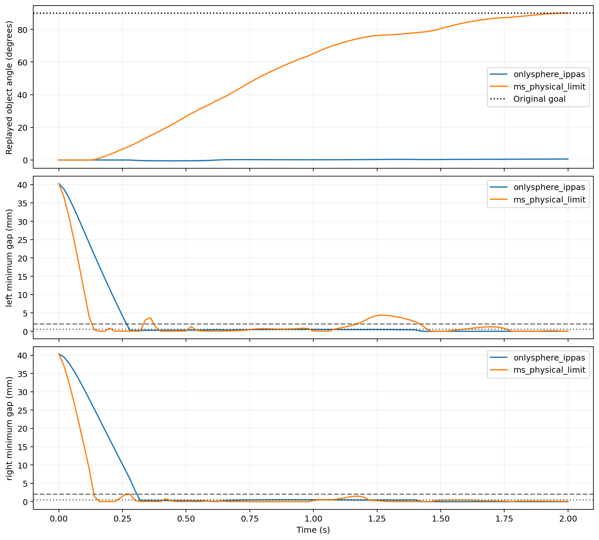
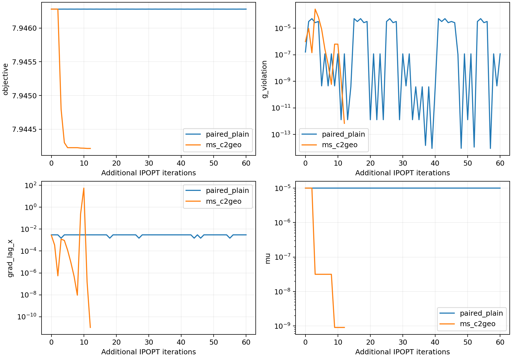

**FingersSphere2d: releasing contact without a guiding cost**

Investigation on 15 November 2026. This extends the [pushing and contact-barrier investigation](../lifted_contact_investigation/REPORT.md) and the [NLP convergence investigation](../lifted_contact_investigation/convergence/REPORT.md). Those reports contain the PushSphere2d, PushBox2d, PushCircularKnob, and PushSquareKnob experiments, the five original observations, and localized KKT violations. This report addresses the subsequent request to find a better finger trajectory, including with ordinary multiple shooting.

**A better trajectory was found from the original linear interpolation, using the original cost.** Ordinary multiple shooting, followed by a continuation with full constraint curvature, finds a left-finger release and recontact at a different location on the sphere. A final continuation makes the contact model consistent with its zero-smoothing limit. Its controls replay under the original zero-smoothing Hunt–Crossley simulator to a sphere angle of **90.027°**, with **0.639 mm** final position error and objective **7.57873**. The optimization itself converges at small positive smoothing: maximum equality defect **4.70e-12**, maximum unscaled stationarity residual **4.03e-9**, and bound complementarity **9.09e-10**.

These are different measurements: the KKT certificate belongs to the positive-smoothing optimization model; the replay measurements belong to the original zero-smoothing forward model. The latter has no dynamics defects because its states are generated by simulation. I have not obtained a converged zero-smoothing NLP for this turning trajectory.



The [animation](figures/comparison.gif), [numerical results](results.csv), [independent validation](validation.json), [contact events](contact_events.json), and all individual trajectories and solver histories in [data](data) accompany this report.

**Finger–finger collisions have been removed as requested.** The task XML now assigns the finger capsules `contype=1, conaffinity=2`, and the sphere `contype=2, conaffinity=1`. Finger masks have no matching bit with one another. The compiled MJX model contains exactly these four pairs:

| Sphere geom | Finger geom |
|---|---|
| 4 | 0: left proximal capsule |
| 4 | 1: left distal capsule |
| 4 | 2: right proximal capsule |
| 4 | 3: right distal capsule |

The visual angle marker remains excluded. There are now 16 pyramidal force variables per stage, compared with 32 under the former eight-pair model. Geometrically overlapping fingers are allowed under this requested collision model. The production change is confined to [the task XML](../../mujodico/examples/tasks/fingers_sphere_2d.py); experimental optimizer and constitutive-law modifications live in the report programs.

The experiments started before that change retain the original eight contacts. They are labeled separately in the results table and are used only as evidence about those particular formulations. The principal comparison below uses the same updated four-pair task throughout.

**The initialization and objective do not encode a regrasp.** The task has 14 states, four velocity-command controls bounded by ±1, 100 intervals, and a 0.02 s timestep. The initial finger angles are `[30,-60,-30,60]` degrees; the sphere starts at `(0,0.25)` m with zero rotation. The goal is the same sphere position and a 90° turn. Finger positions and velocities are not penalized directly. The original running weights, terminal weights, control regularization, horizon, and actuator bounds are retained in every selected phase.

The first phase uses `task.xs_init` and `task.us_init` exactly: sphere angle interpolates linearly from 0° to 90°, finger states stay at their initial values, all velocities are zero, and all controls are zero. The angle interpolation is consequently dynamically infeasible. Every subsequent warm start is an optimizer-produced iterate from that same initial run. No path was drawn, no release/recontact times or locations were constrained, and no intermediate target, clearance reward, contact schedule, finger waypoint, or added guiding cost was used. The initial state/control SHA256 is `d852edbd769fa2a8d2cdd56a222362c06ce2bd0bfaf8fe32a3693fb62e8cd1a1`.

**The contact-force barrier that helped the pushing tasks can oppose release here.** For the lifted formulation, write the constitutive forces as `Fκ(x,u)`, with force decisions `λ=Fκ(x,u)` and redundant bounds `λ≥0`. On that equality manifold the force-bound barrier contributes

$$
-\mu\sum_i\log F_{\kappa,i}(x,u).
$$

At a separated contact with a reciprocal tail, `Fκ≈Cκ/g`, where `g` is predicted separation. Its gap derivative is approximately `μ/g`; the smoothing amplitude cancels from the logarithmic derivative. Reducing smoothing alone does not therefore remove the barrier's attraction toward smaller predicted separation. The earlier pushing experiments directly isolate this effect with force-bound removal and an equivalent force-inequality formulation without lifting.

With two fingers, the optimizer can use a useful initial attraction to make contact and subsequently be penalized by the finite barrier when it reduces any contact force to release. In a pyramidal representation there are four force-ray bounds per candidate pair. Their combined barrier depends on the force representation and the list of candidate pairs; it is not an invariant physical preference. The old finger–finger pairs also introduced barriers for interactions the user did not want.

This is a finite-barrier search bias, rather than an added physical adhesive force or an additional term in the final task objective. It need not disappear in practice if the solver fails to solve its current barrier subproblem and consequently keeps `μ` large. For the four-pair native IPPAS run, `μ` remains **0.1** after 500 iterations, with dual error **65.65** and primal defect **0.03167**. That run should not be interpreted as a stationary solution of the original NLP that proves regrasping is disadvantageous.

The observation is solver-dependent: the four-pair lifted IPOPT baseline does contain two small left-finger release/recontact events under the gap thresholds used below. It nevertheless remains unconverged and replays with 52 mm position error. The evidence supports a contact-retention bias and a particularly sticky native IPPAS run, rather than a claim that lifted optimization can never release contact.

**Relaxing the redundant force bound weakens this bias, but was insufficient on its own.** Replacing `λ≥0` by `λ≥-ρ`, while retaining `λ=Fκ(x,u)` and a nonnegative constitutive law, preserves the feasible physical solutions. The reduced barrier becomes `-μ log(Fκ+ρ)`. Compared with the original barrier, its derivative is multiplied by

$$\frac{F_\kappa}{F_\kappa+\rho}.$$

Thus a positive offset suppresses attraction from weak separated contacts without asking for a particular motion. It does permit temporary negative force decisions at infeasible iterates; the force equalities must still be checked before treating a result as physical.

In the original eight-pair IPPAS comparison, `ρ=0.01` reduced the 500-iteration objective from **50.605** to **9.093**, and the nominal replay included a 180 ms left-finger release/recontact. Neither NLP converged. With only finger–sphere contacts, the analogous IPOPT offset run improves on the unmodified lifted baseline but still stalls. Removing every force bound or increasing the offset further produced attractive planned costs with substantial dynamics/force inconsistency. They were not accepted as solved trajectories.

Adding gap inequalities to balance the force barrier, replacing four ray bounds by one normal-force bound, starting with a very small barrier parameter, using a much wider contact tail, and directly enforcing the implicit contact law with the next-velocity decision were also tried. None produced a better converged four-pair solution than the multiple-shooting continuation. Several of these trials used the earlier eight-pair model; they are exploratory negative results, rather than a controlled ranking of all options on the final task.

**Ordinary multiple shooting removes the explicit force barrier and succeeds here.** The experiment uses states and actuator controls as decisions, with dynamics equalities `x[k+1]=fκ(x[k],u[k])`. There are no force decisions and no contact-force positivity inequalities. It uses the same smoothed forward step in values and derivatives. This last detail matters: the repository's standard `shooting_transcription` returns zero-smoothing values and substitutes positive-smoothing derivatives with `stop_gradient`. That hybrid is not the derivative of a single fixed smooth NLP. The experimental shooting branch is a deliberately consistent alternative.

Unlike the original separated PushSphere2d case, where consistent ordinary shooting converged to a no-push local minimum, the finger problem finds a useful basin from its angle-interpolating start. The task geometry, two actuators per finger, friction, and goal-directed infeasible state samples give different local search information. This experiment demonstrates that the force barrier is unnecessary for this particular successful finger sequence; it does not establish a universal contact-discovery method.

The selected continuation proceeds as follows:

1. **Discover motion:** ordinary multiple shooting, actual `κ=1e-5`, objective Hessian only, 1000 iterations, inner solve cap 60 and both inner tolerances `1e-10`. This phase discovers release/recontact but remains dynamically infeasible: objective 7.255 and maximum continuity defect 0.415. Its planned cost is not the final result.
2. **Restore curvature and feasibility:** continue with the full Lagrangian Hessian and inner cap 100/tolerances `1e-12`. The optimizer reaches an almost feasible trajectory around objective 7.946 but cycles near a capsule projection boundary. A checkpoint saved by the generic criterion “equality violation below `1e-5` and improved objective” at iteration 373 supplies the next phase. It was not selected for a prescribed contact event.
3. **Smooth the closest-feature transition:** replace the hard segment projection clip locally by a C2 clip of dimensionless width `0.001`. From that checkpoint IPOPT converges in **12 iterations**, at objective **7.944215**, equality defect **6.82e-13**, and stationarity **1.05e-11**. Restoring the original geometry and continuing converges again in **six iterations**, with the same cost and **1.12e-14** equality defect. The geometry modification helped the search finish; it is not active at the final sampled solution.
4. **Make the smoothing limit consistent:** retain the original cost, full Hessian, accurate inner solve, and small geometry regularization during the transition; set the additional Hunt–Crossley time scale to zero and reduce `κ` to `1e-7`. IPOPT converges in **112 iterations**, at objective **7.590058** and the KKT residuals reported above. The geometry regularization is again inactive at the final stage samples. Replay with the original hard geometry and original zero-smoothing law gives the reported objective **7.578731** and near-exact turn.

The phase lengths and numerical settings were chosen empirically. The sequence uses optimizer continuation rather than a new hand-designed initial trajectory, but it is not yet a tested general automatic switching policy.

**Geometry smoothing addresses a different issue from contact smoothing.** A capsule–sphere contact projects the sphere center onto a capsule segment, with a hard clip of the projection parameter to `[0,1]`. Smoothing the penetration force does not smooth this closest-feature transition. The C2 replacement uses `clip(t)≈r(t)-r(t-1)`, where, for `s=(t+e)/(2e)` in the transition,

$$r(t)=e(2s^3-s^4),\quad -e<t<e,$$

and is exactly zero or exactly `t` outside that interval. It matches two derivatives at the joins. With `e=0.001`, the maximum projection displacement at a segment end is about 28 µm for a proximal capsule and 17 µm for a distal capsule. This changes a local geometry calculation, not the objective.

At the frozen pre-finishing checkpoint, one projection lies within the transition: the right distal capsule at stage 98 has parameter **1.000491**. At the converged `ms_c2geo` point, the nearest projection boundary is **0.001350** away in parameter space; all stages are outside the C2 modification. The original-geometry convergence and matching original-geometry smoothed replay independently confirm that this phase did not obtain its final cost by retaining a modified capsule shape. The corresponding minimum boundary distance in `ms_physical_limit` is **0.001364**, also outside the transition.

The unmodified full-Hessian continuation shows persistent stationarity around `0.00299` while objective is almost unchanged and continuity repeatedly becomes tiny. This is another concrete example of an objective plateau with incomplete NLP convergence. The successful C2 finish supports smoothing closest-feature transitions as a practical intervention. It does not prove that geometry is the sole source of every cycle or that the underlying hard-contact trajectory problem is globally solved.

A controlled restart from the same frozen primal point and multipliers gives:

| Finishing model from the identical checkpoint | Additional iterations | Objective | Equality defect | Stationarity | Status |
|---|---:|---:|---:|---:|---|
| Original projection, `paired_plain` | 60 | 7.946280 | 1.16e-7 | 0.002989 | Iteration limit |
| C2 projection, `ms_c2geo` | 12 | 7.944215 | 6.82e-13 | 1.05e-11 | Success |

Both use full Lagrangian curvature, tight inner solves, `κ=1e-5`, the same `μ` initialization, and the original cost. The reported `initial_objective` is 7.946279751778084 in both artifacts; `frozen_ms_seed` is an immutable copy of the checkpoint used by the earlier C2 run.



**Correcting the contact-model limit is essential for a useful replay.** In the original Hunt–Crossley implementation, the penetration argument is

$$-\phi_0-(h+\tau)v_n,$$

with `τ=h` for every positive smoothing value and `τ=0` at exactly zero smoothing. Simply taking `κ` small does not approach the zero-smoothing law: the predicted penetration uses `2h v_n` on one side of the limit and `h v_n` on the other.

The fully converged `ms_c2geo` trajectory is an instructive failure if judged only by its own NLP. Its nominal replay matches the planned trajectory to **6.65e-13** in maximum state difference, with approximately 89.15° final rotation. But the same controls under the original zero-smoothing model end at **60.72°**, have **67.4 mm** position error, and cost **13.5824**. That replay also exceeds a finger joint bound by approximately **0.0123 rad**. No amount of additional KKT polishing of the original positive-smoothing NLP can establish that its controls solve a different contact model.

The selected final phase holds `τ=0` while maintaining a small positive reciprocal penetration smoothing. Its contact model now tends toward the original zero-smoothing law. This simultaneously changes `τ` and `κ` in the tested continuation, so the improvement should not be assigned quantitatively to either change alone. The independent scalar law analysis nevertheless establishes why reducing `κ` without addressing `τ` cannot remove the original discontinuity.

The harness restores every contact-law and geometry patch before independent replays. For a run with modified `τ`, the saved field `replay.smooth` means the repository's **original** positive-κ law, including its original `τ=h`; it does not mean replay under the patched optimization law. `replay.zero` always uses the original zero-smoothing law. The final comparison deliberately uses `replay.zero` for every method.

**The useful release is measurable on the object surface.** A whole finger is considered in contact when either of its two capsule gaps is at most 0.5 mm. A release/recontact event requires prior contact, a whole-finger minimum gap reaching at least 2 mm, at least three intervals before recontact, and subsequent contact within 0.5 mm. Initial approach is excluded. These are analysis thresholds, not optimizer constraints.

For `ms_physical_limit`, the original zero-smoothing replay contains:

| Finger | Release–recontact | Largest gap during event | Change of contact bearing in sphere material coordinates |
|---|---|---:|---:|
| Left | 0.34–0.40 s | 3.69 mm | −5.92° |
| Left | **1.18–1.46 s** | **4.41 mm** | **−30.21°** |

The second event is the substantive repositioning: it contacts a different part of the rotating object, rather than merely returning to the same material point as the sphere rotates. The right finger remains within the strict 2 mm whole-finger release threshold during the selected trajectory, apart from its initial approach. Both fingers are not required to release to accomplish the turn. The controller has not been told which finger should release.

**The comparisons separate planned costs, simulation, and convergence.** All rows below have four candidate pairs and the original task cost. Replay uses the original zero-smoothing model with accurate inner solves, starting from the exact original initial state.

| Method/phase | Planned objective | Maximum NLP equality defect | Zero-smoothing replay objective | Replay angle error | Replay position error | NLP status |
|---|---:|---:|---:|---:|---:|---|
| Native lifted IPPAS, 500 | 54.3715 | 0.03167 | 54.3126 | 89.39° | 84.95 mm | Iteration limit |
| Native lifted IPOPT, 500 | 10.3002 | 0.004705 | 10.1354 | 7.43° | 52.24 mm | Iteration limit |
| Lifted IPOPT, force bound offset 0.01, 1000 | 9.4563 | 0.003647 | 9.3397 | 8.83° | 34.26 mm | Iteration limit |
| Consistent ordinary shooting discovery, 1000 | 7.2552 | 0.4151 | 9.4332 | 14.66° | 8.45 mm | Iteration limit |
| Converged original-positive-law shooting | 7.9442 | 6.82e-13 | 13.5824 | 29.28° | 67.40 mm | **Success for its own NLP** |
| **Shooting with consistent physical limit** | **7.5901** | **4.70e-12** | **7.5787** | **0.0271°** | **0.639 mm** | **Success at κ=1e-7** |
| Condensed original-zero-law shooting | 7.6074 | 0 by construction | 7.6074 | 0.200° | 0.978 mm | Iteration limit: stationarity 0.194 |

The condensed shooting result is an additional successful physical motion with releases by both fingers. It uses original zero-smoothing forward values and explicitly enforced original state bounds, tightened by `1e-5` to avoid joint-limit activation. Its controls were initialized from the earlier optimizer solution, without a prescribed mode sequence. Limited-memory BFGS improves physical execution but fails to finish the KKT equations after 1000 iterations. It is retained as evidence about another formulation, rather than substituted for the better converged continuation.

**Independent replay also checks the default simulator settings.** [validate.py](validate.py) restores the original task, clips controls to the literal actuator bounds, and checks finite states, all state bounds, and exactly four sphere-containing contact pairs. With the task's default inner cap 20 and tolerances `1e-5`, the selected controls give objective **7.578721**, angle **90.02752°**, and position error **0.63867 mm**. With cap 100 and tolerances `1e-12`, they give **7.578731**, **90.02715°**, and **0.63888 mm**. Neither replay violates a state bound.

The optimizer's largest original-bound excess is approximately `1.75e-8`, arising from IPOPT's default bound relaxation; its largest command excess is `6.59e-9`. Independent replay removes even that command excess by clipping. The close agreement shows that the demonstrated improvement does not depend on using tighter execution tolerances than the native simulator.

**There are still substantial shortcomings.** The successful final NLP retains `κ=1e-7`. Reducing directly to `1e-9` in a warm-started full-Hessian run led to restoration and a final equality defect of about **0.1425**, rather than a better certificate. An explicit hard branch removes the known `sqrt(0)` derivative singularity at exactly zero smoothing, but the tested zero-smoothing multiple-shooting continuation still did not converge: after 300 iterations its continuity defect is **0.509** and stationarity **9.18**, despite a tempting planned objective of 6.236. Fixing an AD defect does not make the remaining contact and geometry switches smooth. The zero-smoothing condensed shooting run provides a good feasible motion but still has substantial dual infeasibility.

The experiments therefore establish a successful small-positive-smoothing optimization with a good original-model replay. They do not establish a converged hard-contact optimum, global optimality, a reliable success rate across starts, or a universally best formulation. The discovery and finishing stages use different curvature models and numerical settings. An exact Hessian from the outset was not a universal solution in the earlier pushing investigation. Increasing smoothing substantially in a fresh finger run also led to a poorer basin. A useful next production improvement is an explicit, documented model-continuation interface with independent contact time scale, consistent values and derivatives, selectable constraint curvature, and accuracy tied to outer KKT targets.

The lifted integration has an additional general limitation: it inserts the contact forces and initializes other constraint forces to zero. A forward solve can also contain joint-limit or equality-constraint forces. Thus algebraic equivalence between lifted and ordinary forward integration requires those other forces to be absent or properly included. Finger tasks with active joint limits deserve particular care. This issue was not isolated as the cause of the present lifted baseline's stagnation and should not be conflated with the separately demonstrated force-barrier bias.

**Reproduction and artifacts.** Use the supplied `mujodico` conda environment. CPU/x64 was used throughout, with the repository versions and native task described in the preceding reports. The experimental scripts are headless and avoid the example command's persistent viewer loop.

```bash
conda activate mujodico
export JAX_ENABLE_X64=True
export JAX_PLATFORMS=cpu
export OMP_NUM_THREADS=1 OPENBLAS_NUM_THREADS=1
export MPLCONFIGDIR=/tmp/mujodico-mpl

# Regenerate the selected continuation from the original linear task start.
python reports/fingers_contact_release/reproduce.py --from-linear

# Faster local reproduction from the supplied optimizer-generated checkpoint.
python reports/fingers_contact_release/reproduce.py

# Independently validate the saved selected controls and rebuild comparisons.
python reports/fingers_contact_release/validate.py --label ms_physical_limit
python reports/fingers_contact_release/analyze.py --best ms_physical_limit --replay zero
```

[reproduce.py](reproduce.py) records phase logs and reports solver status, objective, and constraint violation. The supplied frozen checkpoint is the generic best-feasible checkpoint from the original-start polishing run at iteration 373; it contains states, controls, and multipliers. `--from-linear` regenerates that phase rather than requiring a user-provided trajectory. Numerical trajectories and stopping phases can remain sensitive to solver/library/platform changes.

The checkpoint-based reproduction was rerun as `verify_c2` and `verify_physical`: both return IPOPT success, with exactly the same objective and maximum equality defect as the selected runs. Their independent clipped-control replay also reproduces the numbers above. The original unfinished full-Hessian discovery continuation is retained as a [partial log](logs/ms_polish_partial.log) and its frozen checkpoint, rather than represented as a converged final result. The complete 60-iteration `paired_plain` run supplies the controlled original-geometry comparison.

[run.py](run.py) implements the controlled lifted and consistent ordinary-shooting ablations. [shooting_polish.py](shooting_polish.py) implements constrained condensed shooting on the original hard law with the safe derivative branch. [analyze.py](analyze.py) rebuilds the CSV, plots, animation, and material contact changes. Individual JSON files retain actual IPOPT/IPPAS status, unscaled violations, parameters, initialization identity, and replay metrics. Failed low-cost planned trajectories remain in the data instead of being counted as solved tasks.
