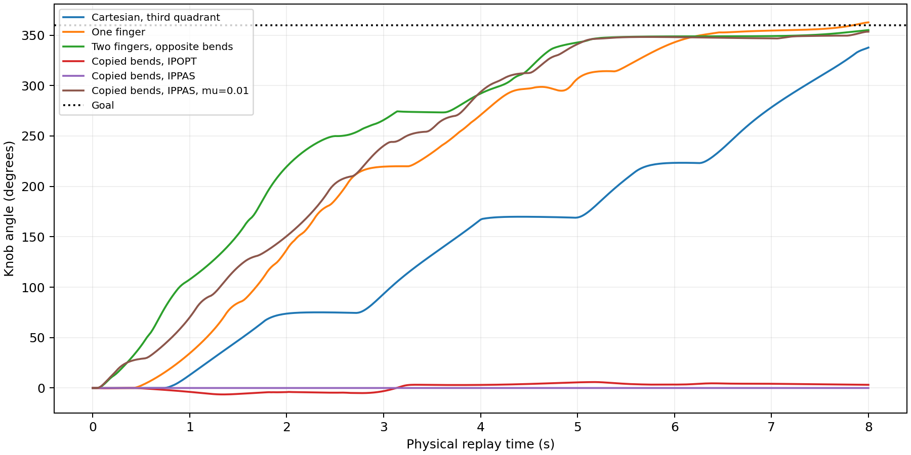
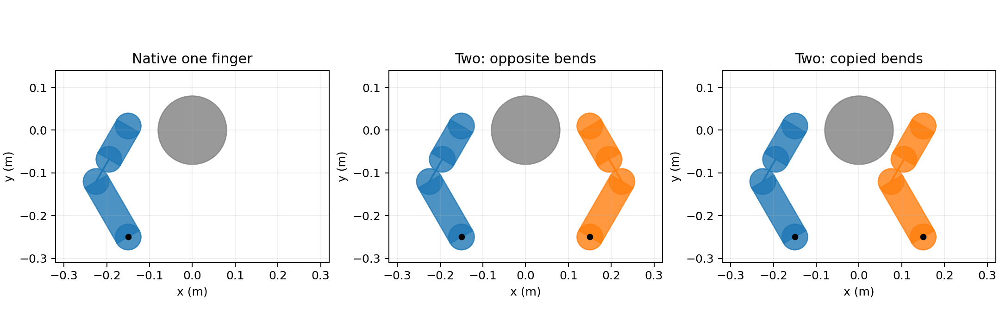

**Finger knob rotation: constraint qualification, conditioning, and contact discovery**

Investigation dated 16 November 2026. The user's clarified two-finger layout has bases at `(-0.15,-0.25)` and `(0.15,-0.25)`, both using the original upward-pointing link geometry, with the knob centered at the origin. The experimental task generator [tasks.py](tasks.py) constructs this layout without modifying production task files. The main failure reproduction copies the original initial joint angles `[30,-60]` degrees to both fingers. A comparison retains those same bases and link frames but initializes the second finger at `[-30,60]` degrees.

**The conjecture identifies a real formulation degeneracy, but it does not explain the observed failure by itself.** An active zero-force bound can indeed violate both LICQ and MFCQ. This happens with one finger and with the Cartesian pusher too. However, in the reproduced two-finger failure the equality Jacobian is structurally full row rank, no joint limit is active, and IPPAS computes accurate Newton directions with an exceptionally well-conditioned stage force-equality Jacobian. It then fails globalization while still far from a feasible contact trajectory. Changing only the initial barrier parameter from 0.1 to 0.01 restores large-rotation discovery without changing the NLP, its degrees of freedom, its constraint qualifications, or the original linear-interpolation warm start.

This does not prove that conditioning and zero-force degeneracy never matter. They are substantial numerical risks. It does distinguish them from a claim that adding finger DoFs inevitably makes the equality and active-inequality gradients dependent.



All angle comparisons below distinguish optimizer states from actual forward replays. Most optimization runs reach an iteration limit or fail line search; recovering motion is not a full NLP convergence certificate. The [complete results table](results.csv), individual [solver results and trajectories](data), and diagnostic programs accompany this report.

**A position-only copy reproduces the failure.** The common setup is 400 intervals of 0.02 s, a 360° goal, the original quadratic angle/control costs, zero initial velocities and controls, and the original linear interpolation of knob angle. Actual smoothing is `1e-5`. Unless specified otherwise, only finger–knob contacts are enabled. There are two candidate pairs per finger: proximal capsule–knob and distal capsule–knob. Native pyramidal friction has four force components per pair.

| Case | Optimized final angle | Positive-κ replay | Zero-κ replay | Termination / equality violation |
|---|---:|---:|---:|---|
| Cartesian pusher restricted to third quadrant, IPOPT | 348.37° | 337.70° | 350.74° | 500 iterations; 0.2175 |
| Native one finger, IPOPT | 359.48° | 362.66° | 358.04° | 500 iterations; 0.3601 |
| Native one finger, IPPAS | 356.06° | 355.72° | 336.13° | 500 iterations; 0.8179 |
| Two fingers, opposite initial bends, IPOPT | 356.28° | 355.04° | 348.85° | 500 iterations; 1.7266 |
| Two fingers, opposite initial bends, IPPAS | 356.74° | 356.45° | 351.19° | 500 iterations; 0.3938 |
| **Two fingers, copied initial bends, IPOPT** | **5.37°** | **3.18°** | **4.17°** | **500 iterations; 41.28** |
| **Two fingers, copied initial bends, IPPAS** | **314.60°** | **−0.0014°** | **0°** | **Line-search failure after 6 iterations; 0.2239** |
| Same copied-bend IPPAS problem, **μ_init=0.01** | 358.27° | **353.45°** | **350.63°** | 500 iterations; 2.2632 |

The large optimized angle in the failed IPPAS row is inherited from an infeasible state trajectory; its controls accomplish essentially no rotation. It must not be counted as a successful turn. Conversely, the successful discovery rows also retain nonzero NLP defects and some replay joint-bound violations, so they must not be advertised as fully solved constrained trajectories.

The two initial-bend choices have the same nominal distal endpoint positions, but different elbow configurations and different capsule contact features. They therefore present substantially different contact-discovery landscapes even before any joint limit is reached.



**The single-finger comparison is not a higher-DoF comparison.** Both PushCircularKnob and FingerCircularKnob have three generalized positions, six states, and two actuator controls. They differ in Cartesian versus revolute actuation, joint ranges, contact geometry, friction, actuator gain, and number of retained contact pairs. Native Cartesian friction is 1, versus 0.3 for the finger; velocity-actuator gains are 10 versus 1, and the control units differ. These changes matter independently of constraint qualifications.

The native single-finger 360° task does produce a large turn in these runs. The additional-finger failure is sensitive to initialization: it occurs for copied bends, but not opposite bends with the same bases. Increasing the target to 720° within the same eight-second horizon also degrades the Cartesian case: the tested positive-κ replays reach approximately 265° for the quadrant pusher, 430° for one finger, and 546° for the opposite-bend two-finger model. Those exploratory results do not establish feasibility of the 720° goal or a universal ordering of the methods. The specific target, time budget, geometry, and initialization must be retained when comparing failure explanations.

**The implemented equalities have a full-row-rank structure.** For the current lifted transcription,

$$x_0=\bar x_0,\qquad x_{k+1}-f_2(x_k,u_k,\lambda_k)=0,\qquad
\lambda_k-F_\kappa(x_k,u_k)=0.$$

Hold all actuator controls fixed and select the Jacobian columns in the order

$$x_0,\lambda_0,x_1,\lambda_1,x_2,\ldots,\lambda_{N-1},x_N.$$

Order the rows as the initial equality, force equality at stage 0, dynamics at stage 0, and so on. The selected square submatrix is block lower triangular with identity diagonal blocks. Its determinant is 1. Thus the equality Jacobian has full row rank wherever the functions are differentiable, irrespective of the rank of the contact-velocity Jacobian or the number of fingers. This argument specifically uses the implemented current-state forward force predictor; it is not a statement about every possible contact-implicit formulation.

The dimensions confirm that adding force equalities has not consumed all control freedom:

| Task | Variables | Equality rows | Remaining equality-tangent dimension |
|---|---:|---:|---:|
| Cartesian, one candidate pair | 4806 | 4006 | 800 |
| One finger, two candidate pairs | 6406 | 5606 | 800 |
| Two fingers, four candidate pairs | 12010 | 10410 | 1600 |

The stage force-equality control Jacobian is especially simple:

$$E_u=[-D_uF_\kappa\quad I],\qquad E_uE_u^T=I+D_uF_\kappa(D_uF_\kappa)^T.$$

Its smallest singular value is at least 1. Adding fingers cannot make those rows dependent merely by increasing their number. This does not guarantee a well-conditioned *whole* KKT system, and active inequalities can still introduce dependence.

**LICQ and MFCQ are distinct tests.** LICQ requires the equality and active-inequality gradients together to be linearly independent. MFCQ requires independent equality gradients and a direction tangent to the equalities that points strictly inward for every active inequality. Duplicate same-direction inequalities violate LICQ but can still satisfy MFCQ. A rank test alone therefore does not diagnose MFCQ.

In this particular formulation, however, an active differentiable zero-force component gives an exact certificate of failure of both. Every pyramidal predicted force component is nonnegative. At a smooth point with `F_i=0`, nonnegativity implies

$$\nabla F_i=0.$$

The force-equality gradient becomes `∇(λ_i−F_i)=e_{λ_i}`, identical to the active lower-bound gradient `∇λ_i=e_{λ_i}`. LICQ fails. Any equality-tangent direction must have `dλ_i=0`, while MFCQ would require `dλ_i>0`; no such direction exists. Equivalently, an equality multiplier −1 and bound multiplier +1 give a positive-dependence/Farkas certificate. No numerical rank threshold is needed.

This can happen even at positive smoothing. The reciprocal penetration smoother is positive in separation, but Hunt–Crossley's velocity-dependent local ReLU has compact support. Sufficiently separating constraint velocity makes a component exactly zero, with exactly zero derivative. In a reduced formulation imposing `F_i(x,u)≥0` directly, the same issue appears as an active inequality with a zero gradient.

This reasoning should not be replaced by an automatic appeal to MPCC degeneracy. Classical complementarity reformulations often fail standard MFCQ, as discussed by [Coulibaly and Orban](https://optimization-online.org/wp-content/uploads/2009/11/2458.pdf). The present positive-smoothing force-equality NLP is not an exact complementarity program and also has strictly interior feasible trajectories. Its zero-force cases need the specific argument above.

**The zero-force degeneracy is shared by the Cartesian task.** [diagnose.py](diagnose.py) constructs feasible trajectories by predicting forces and integrating exactly the same given-force dynamics as the NLP. One probe uses zero controls; another briefly retracts the pusher or finger, then leaves controls at zero. These are diagnostic trajectories, not optimizer initializations.

| Feasible probe | Zero-force components with exactly zero gradient | State-bound violation | Maximum dynamics defect |
|---|---:|---:|---:|
| One finger, zero controls | 0 | 0 | 1.63e-19 |
| Two fingers, zero controls | 0 | 0 | negligible |
| Cartesian quadrant, zero controls | 0 | 0 | 6.78e-21 |
| One finger, brief retreat | **92** | 0 | **5.55e-17** |
| Cartesian quadrant, brief retreat | **100** | 0 | **3.39e-21** |

The cold trajectories have positive forces and strict state/control-bound slack, so the equality-rank proof establishes LICQ and MFCQ there. The retreat trajectories give explicit zero-force certificates of failure. Hence adding a second finger does not make qualification failure inevitable, and successful Cartesian release behavior does not establish that the Cartesian formulation avoids it.

Both IPOPT and IPPAS also expand finite bounds by default. At an original force lower bound zero, the working lower bound is approximately `−1e-8`. A physical force of zero is then strictly inside the *relaxed* bound. The original NLP's exact degeneracy becomes a small-slack numerical problem in that working formulation. With `μ=0.1`, a force slack near `1e-8` produces multiplier scale `μ/s≈1e7` and barrier curvature `μ/s²≈1e15`. These scales can cause severe conditioning and contact-retention pressure without an exactly singular working Jacobian.

**The reproduced IPOPT failure is not at active joint limits.** At its final copied-bend iterate:

- Minimum joint-position slack is **0.46673 rad**, about **26.7°**.
- Minimum actuator-command slack is **0.00313**.
- Minimum lifted-force lower-bound slack is **0.00017275 N**.
- The equality Jacobian retains its triangular identity structure.

All these variable bounds are strictly inactive. The hypothesized rank loss from stacking the equality Jacobian and active joint/force-bound rows is therefore absent at this saved iterate. The point is also highly infeasible: its raw equality defect is **41.28**. Classical qualifications at feasible solutions cannot be inferred from a stalled infeasible trajectory. In particular, the 137 predicted zero-force components found at its sampled `(x,u)` are not 137 active force bounds at that primal iterate: the force decisions are positive and do not match the predicted forces.

The initial distal sticking-velocity Jacobian also has full row rank in both initializations. Its singular values for the copied-bend model are approximately `(0.29316,0.16450,0.04495,0.01740)`, versus `(0.29317,0.29315,0.04986,0.02634)` for opposite bends. These values show changed mechanical conditioning, not a lost row. Over the stored IPOPT trajectories, the minimum is about 0.00372 in the failed copied-bend run and 0.00329 in the successful-discovery opposite-bend run. That kinematic rank diagnostic does not separate success from failure either.

**The IPPAS failure is globalization of an inaccurate trajectory, not a failed equality-rank test.** [trace_failure.py](trace_failure.py) logs the actual six iterations. At the final failed direction:

- Stage force-equality control singular values lie between approximately **1** and **1.00000125**.
- The Newton linear-system defect is **7.28e-12**.
- The solver accepts the direction as numerically valid; both primal and dual regularization are **zero**.
- The unscaled proposed joint-position correction reaches **2.46 rad** at a future node.
- The maximum fraction-to-boundary step is about **0.442**, but filter backtracking reduces the last trial to **8.43e-7**, which is still rejected.

Thus an accurate linear solve is proposing a very large posture/force correction to an infeasible trajectory. On the last trial the barrier objective rises from **8975.18528** to **8975.19312**, while the aggregate equality/slack residual decreases only from **70.474464** to **70.474405**. The task-objective directional derivative is about **+9166.75**, and the slack-barrier contribution is **+134.39**. This is a feasibility-correction direction that increases the objective, rather than a descent direction blocked by a detected equality singularity. Larger steps fail the filter; sufficiently small ones deliver too little feasibility progress. The implementation then returns line-search failure.

The actual force-prediction Jacobian at the worst force-defect stage agrees with finite differences to normalized row discrepancy about **3.8e-9** under default inner settings. The normalization is `max(1, ||finite-difference row||)`, so this is not necessarily a relative percentage of a tiny derivative. Tightening the inner solve to 100 iterations and `1e-12` tolerances leaves the same six-iteration failure essentially unchanged. Inner derivative inaccuracy is therefore not the cause of this particular early failure. It matters elsewhere: the original one-finger 500-iteration endpoint has normalized discrepancy about **0.0133** at its worst force-defect stage, which tight inner solves largely remove.

**The cleanest intervention changes the search without changing any constraint qualifications.** Reducing `μ_init` from 0.1 to 0.01 on the copied-bend IPPAS problem retains the original joint-angle initialization, linear interpolation, task objective, geometry, bounds, force equalities, and positive-smoothing model. It finds a 353.45° positive-κ replay and a 350.63° zero-κ replay. This changes the finite-barrier path and the resulting force/posture corrections; it does not change LICQ/MFCQ of the final NLP.

The run remains unconverged, and its positive-κ replay exceeds a joint bound by about 0.00473 rad. The result establishes recovery of motion discovery, not a production-quality feasible optimum. It nonetheless rules out an intrinsic inability of the added DoFs to turn the knob.

Other interventions separate useful effects from universal claims:

- Replacing force bounds by `λ≥−0.01` preserves the feasible physical solutions because `λ=Fκ≥0`. It removes zero-force active-bound degeneracy and weakens small-force attraction. IPOPT then finds a 359.16° positive-κ replay, but IPPAS still fails early. The modification changes both regularity and the finite-barrier path, so its success cannot be assigned to regularity alone.
- Giving IPPAS initial lifted forces of 0.01 does not fix the copied-bend failure; it still replays to zero rotation. The issue is not merely zero initial lifted force.
- Enabling the full Lagrangian Hessian from the start produces an almost feasible but nearly nonmoving IPPAS iterate: approximately 0.069° positive-κ replay, raw defect `3.22e-8`, and all force and joint bounds strictly slack. It still fails the final KKT tests after 500 iterations: `μ=0.1`, dual error about 5.88, and complementarity 0.1. Restoring curvature is not a universal contact-discovery strategy.
- Adding the four finger–finger candidate pairs, without changing DoFs or initial joint angles, also changes the search basin: the copied-bend models then find about 356° and 354° positive-κ replays under IPOPT and IPPAS. More force constraints did not monotonically worsen discovery. Such contact pairs should be chosen for the intended physical model, not added as an undocumented guiding device.

**The second finger can be left idle while the first performs a large turn.** As an independent physical diagnostic, [embed.py](embed.py) applies the one-finger optimized controls to the original finger and zero controls to the added finger in the copied-bend model. Uniformly scaling the first controls by 0.99 gives **338.75°** under the positive-κ model with **zero state- or command-bound violation**. Scaling by 0.95 gives **307.95°** under the original zero-κ model, also with **zero state- or command-bound violation**. These are forward-generated trajectories, not infeasible optimizer states. They demonstrate that the failed near-zero motion is not imposed by the available physical DoFs or by unavoidable joint-limit incompatibility. They do not certify optimality or completion of the exact 360° goal.

Those controls were not used as initial guesses in the comparisons above; every discovery run starts from its specified original interpolation. The embedding is a feasibility/control-authority check only.

**There are real kinematic bottlenecks, but they are different matrices from the NLP equality Jacobian.** In an assumed sticking contact mode, write the velocity relations as

$$C_f(q)\dot q_f+c_\theta(q)\dot\theta=0.$$

To turn the knob while retaining that mode, one needs compatible joint motion. Near a singular `C_f`, a unit knob speed can demand very large joint velocities even if the full matrix `[C_f,cθ]` has independent rows. Its nullspace can predominantly reconfigure the fingers while making almost no knob-angle progress. Joint bounds can likewise terminate a contact stroke even when every relevant equality row is independent. A useful continuation then requires slipping, releasing, changing contact feature, or regrasping.

[stroke.py](stroke.py) imposes a sticking-mode continuation from selected replay poses. It is a kinematic probe, not a force-, actuator-, or time-feasibility certificate. The Cartesian and single-finger examples reach a workspace/joint boundary after additional rotations of about 15.1° and 76.9° from those particular starting poses. The two-finger continuation reaches a joint-to-contact output singularity after about 1.70°. At that endpoint the minimum singular value of the joint-only map is `1e-5`, but the full contact-velocity matrix still has minimum singular value about **0.00331** and full row rank. Its unit nullspace direction has knob-angle component only **0.000418**. Maximum contact-gap drift in that continuation is below 0.64 µm.

These starting poses are different and the numbers are not maximum stroke limits for the tasks. The example establishes a distinction: a contact mode can become ineffective for the desired output while its constraint rows remain independent. Extra contacts can create this kind of bottleneck, and a local optimizer must change mode to escape it. This is a plausible source of poor multi-finger robustness. It is **not** the explanation for the reproduced six-iteration failure, which occurs before either finger reaches geometric contact.

**Candidate-contact barriers add further search bias.** Each proximal link has maximum axis reach 0.15 m from a base at distance `sqrt(0.15²+0.25²)` from the knob. Its minimum possible gap is therefore

$$\sqrt{0.15^2+0.25^2}-0.15-0.03-0.08
=0.03155\text{ m}.$$

These pairs can never make physical contact. At positive smoothing they nevertheless have nonzero predicted forces and four force barriers each. A two-finger model doubles such unreachable pairs. Reciprocal tails make their normalized barrier gradient survive small smoothing, so adding a finger changes the finite-barrier objective even when the added finger ought to remain idle. Joint-position barriers also bias finger posture; their effect is not equivalent to a Cartesian workspace bound.

This is a plausible way for additional contacts and elbow configurations to compete with useful contact discovery. It must not be promoted to a complete isolated cause: removing proximal pairs in an opposite-bend two-finger trial made discovery worse, not better. The same attraction that is unhelpful during reset can help establish initial contact. The controlled μ change and initial-bend comparison provide stronger evidence about the failure here than a blanket rule to remove every distant contact.

**What follows for diagnosis and implementation.** A rank test should be applied to a locally smooth, sufficiently feasible point with a carefully defined active set. Tiny positive force is not an exactly active constraint, and a negative infeasible force decision is not an active feasible bound. Row/column scaling and the long multiple-shooting horizon can also make numerical singular values misleading.

For this implementation, first use the structural equality-rank result. For active inequalities `G`, LICQ can then be checked using `GZ`, where `Z` spans the equality nullspace. MFCQ can be tested by maximizing `t` subject to `Aeq d=0`, `Gd≥t`, and a scaled bound on `d`. A projected zero force-bound row gives the exact certificate above. An ordinary rank deficiency alone does not distinguish redundant same-direction inequalities from an absence of any inward direction.

The practical findings support monitoring original-bound slacks, force consistency, primal/dual residuals, complementarity, μ, and replay—not merely knob angle. A smaller or staged force barrier can improve discovery; shifted redundant force bounds can regularize zero-force faces; accurate inner solves and full curvature are finishing tools after a useful trajectory has been found. None is a proven universal fix. All native moving examples here still require further NLP polishing and original-model execution validation.

The strongest conclusion is that the observed two-finger zero-rotation behavior is a **contact-discovery/globalization failure on a particular initialization**, accompanied by the broader numerical difficulty of redundant force barriers. Formal LICQ/MFCQ failure is real at certain zero-force faces, but it is neither unique to fingers nor an adequate stand-alone explanation of the reproduced failure.

**Reproduction and scope.** The programs are headless and use the supplied `mujodico` conda environment. Run from the repository root:

```bash
conda activate mujodico
export JAX_ENABLE_X64=True JAX_PLATFORMS=cpu
export OMP_NUM_THREADS=1 OPENBLAS_NUM_THREADS=1

python reports/knob_constraint_qualification/run.py --label finger --task finger
python reports/knob_constraint_qualification/run.py --label quadrant --task quadrant
python reports/knob_constraint_qualification/run.py --label two --task two
python reports/knob_constraint_qualification/run.py --label two_copied --task two --same-joint-angles
python reports/knob_constraint_qualification/run.py --label two_copied_ippas \
  --task two --same-joint-angles --solver ippas
python reports/knob_constraint_qualification/run.py --label two_copied_mu_ippas \
  --task two --same-joint-angles --solver ippas --mu-init .01

python reports/knob_constraint_qualification/diagnose.py --label finger
python reports/knob_constraint_qualification/diagnose.py --label quadrant
python reports/knob_constraint_qualification/trace_failure.py
python reports/knob_constraint_qualification/accuracy.py --label two_copied_ippas
python reports/knob_constraint_qualification/embed.py
python reports/knob_constraint_qualification/stroke.py
MPLCONFIGDIR=/tmp/mujodico-mpl python reports/knob_constraint_qualification/analyze.py
```

The final task comparison uses the same-y, different-x bases clarified by the user. Exploratory files named `two_x*` reflect an earlier interpretation with an upper base and a downward finger; they are retained as raw experiments but excluded from this explanation. The complete CSV records geometry flags so those cases cannot be mistaken for the clarified task. No production solver changes or extra guiding cost were introduced.
