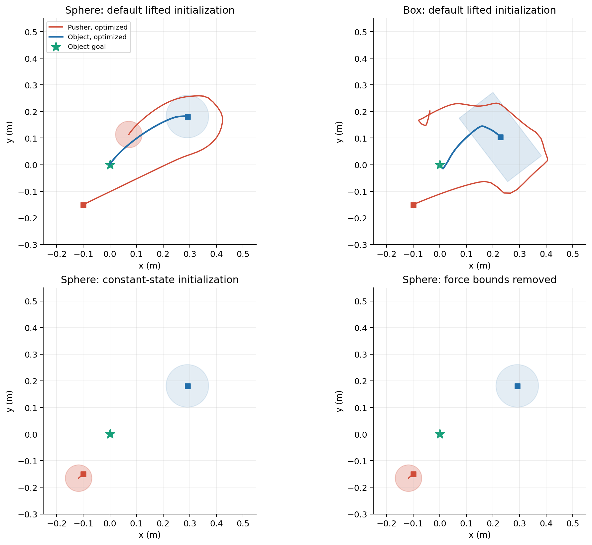
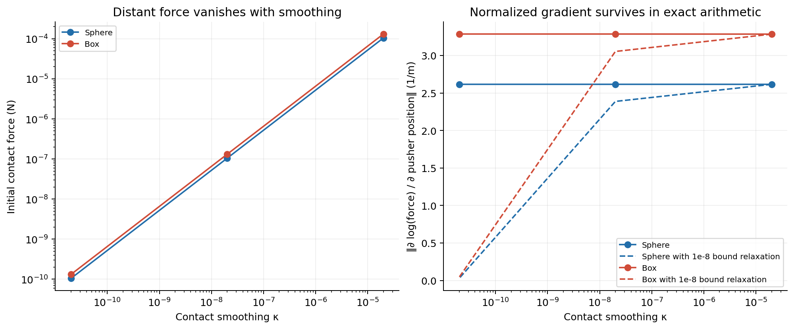
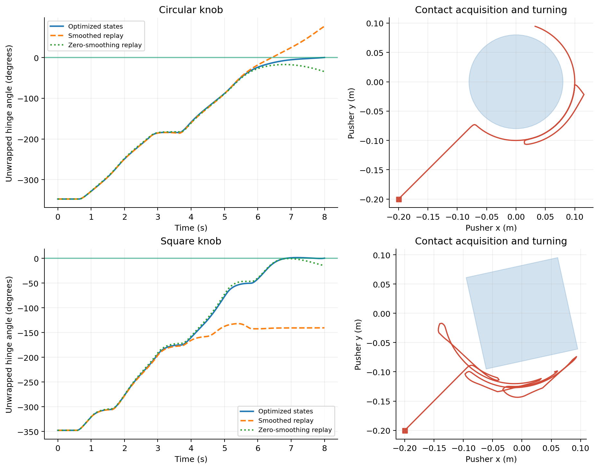
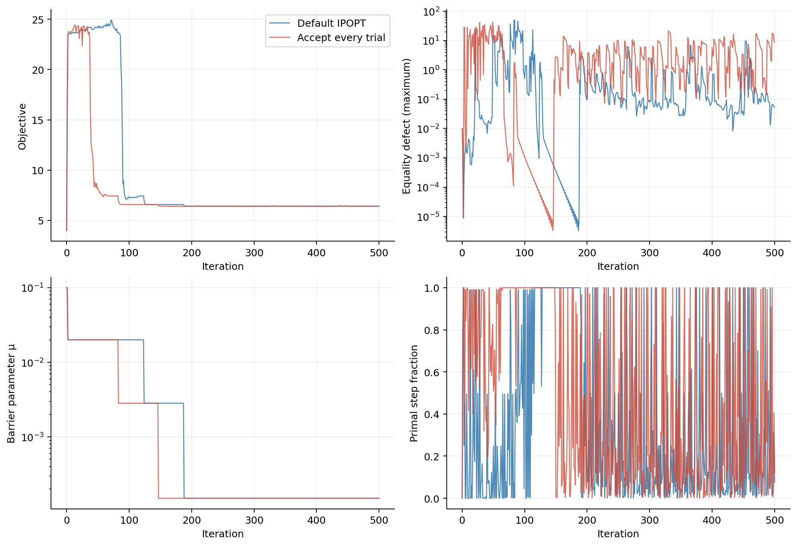
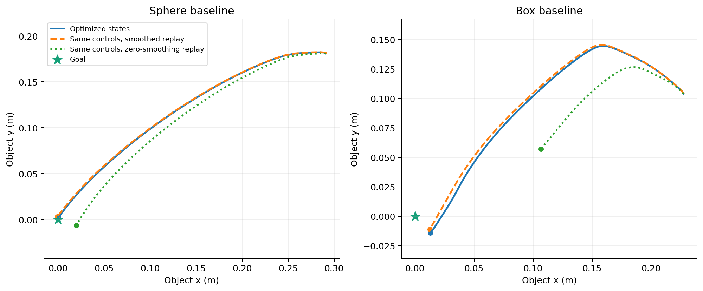

**Why interior-point trajectory optimization discovers pushing motions with lifted contact forces**

The [finger-knob constraint-qualification follow-up](../knob_constraint_qualification/REPORT.md) investigates the effect of joint limits and an added finger. It reproduces a position-only copied-finger failure, separates a genuine zero-force LICQ/MFCQ defect from equality-rank and contact-mode issues, and recovers large-rotation discovery by changing only the initial barrier parameter.

Investigation of MuJoDiCo revision `75fe4194370516bd0e1ebebabb10ff2d69a92155`, 15 November 2026. The experiment programs, individual results, scalar iteration histories, sampled primal iterates, replay trajectories, and figure sources accompany this report. Library and task implementations were left unchanged.

The evidence includes 46 saved solver runs across the original pushing tasks and the two native frictional knob tasks, plus derivative, constitutive-law, cone-consistency, and replay probes. One further configuration, frictionless elliptic contact, is rejected during model-data allocation and is recorded as an unsupported case.

A subsequent [convergence investigation](convergence/REPORT.md) identifies the failed KKT tests and tests local finishing phases. It achieves full IPOPT convergence for the saved moving sphere trajectory by restoring constraint curvature, and for the circular knob by combining full curvature with tighter inner contact solves. The 500-iteration results below describe the original default runs, rather than an inherent inability of the formulation to converge.

The later [FingersSphere2d regrasp investigation](../fingers_contact_release/REPORT.md) addresses the force barrier's tendency to retain contact. It removes finger–finger collision pairs as requested, finds a converged ordinary-multiple-shooting continuation from the original linear interpolation without a guiding cost, and validates a release/recontact trajectory under the original zero-smoothing forward model. The statement above about unchanged task implementations applies to the original pushing experiments; the later finger task includes the requested collision-mask change.

The [sideways and far-side discovery follow-up](../contact_route_discovery/REPORT.md) separates contact attraction from directional steering. Nine additional experiments show that sphere normal-direction derivatives and the box's initial flat-face moment-arm derivative provide task-weighted lateral signals. Removing those derivative paths preserves forward values but prevents route discovery in the tested runs. A symmetric sphere initialization fails to turn, while opposite 2 mm offsets select opposite routes. Thus the force barrier alone is an incomplete explanation of circumnavigation.

**The main mechanism is the contact-force barrier.** Lifting introduces nonnegative force variables, and an interior-point method consequently applies a logarithmic barrier to those forces. With a reciprocal contact tail, eliminating the force variables converts that barrier into an attraction toward contact whose gradient is approximately independent of contact smoothing. Independent state variables, temporarily inconsistent forces, and the chosen Hessian approximation then give the solver room to change the contact geometry and find the far side of the object.

Two ablations make this more than a plausible interpretation. Removing the explicit force bounds, while retaining the force equalities and lifted dynamics, makes both original tasks settle at a no-push solution. Conversely, ordinary multiple shooting with consistent smoothed dynamics and the same redundant force-positivity inequalities discovers essentially the same circumnavigation as lifting. Thus, the coordinate change alone does not explain the behavior.

There is also an important qualification to “works”: the default runs reproduce circumnavigation and low error in the optimized state variables, but the tested moving solutions generally do **not** satisfy the NLP convergence tolerances within 500 iterations. Replaying their controls reveals additional error. Discovery of a useful contact sequence, convergence of the optimization, and accurate execution under the intended dynamics are three separate outcomes.

| Original observation | Finding |
|---|---|
| A nonmoving, separated trajectory is not stationary for the interior-point solver. | The finite-barrier problem and the default infeasible initialization explain movement. A correctly implemented hard-contact problem still has a stationary no-push local minimum. |
| Pyramidal contact is required. | The original sphere and box are frictionless. Elliptic `condim=1` is explicitly unsupported in this checkout. Frictional comparisons also expose a mismatch between the elliptic forward law and the lifted cone constraint. |
| The reciprocal ReLU is required. | An algebraic ReLU also discovers the route on both sphere and box. A representable algebraic tail is the useful property; compact smoothing and the tested softplus lose that tail. |
| Line search has little effect. | It is not necessary for discovering these routes, but it materially affects residuals. Accepting every trial still retains fraction-to-boundary step restrictions. |
| The same behavior extends to frictional turning tasks. | Native pyramidal knob tasks discover near-complete planned turns. Replays are substantially less accurate; the circular knob also supplies a counterexample to line-search independence. |
| Lifting works with 1000 times less smoothing, but needs nonzero smoothing. | A force barrier explains why small tails can remain useful. The exact factor is not universal, and the current comparison also changes the forward model. At zero smoothing there is both an AD defect and a genuine loss of the exploration mechanism. |

**The original two tasks provide a controlled starting point.** `PushSphere2d` has eight states, two actuator controls, 100 intervals, and a 0.02 s timestep. Seed 0 starts the pusher at `(-0.1, -0.15)` m and the object at `(0.29109, 0.18094)` m; the object goal is the origin. `PushBox2d` has ten states, 80 intervals, and a 0.05 s timestep. Its seed-0 object starts at `(0.22739, 0.10396)` m with angle `-0.91805` rad. Both XML files set `condim=1`: the successful original examples do not contain tangential contact friction.

The runs used the supplied `mujodico` conda environment, CPU execution, and 64-bit JAX: Python 3.12.13, JAX 0.10.2, MuJoCo 4.0.0, and IPOPT 3.14.19. The GPU driver was unavailable. Most controlled ablations use IPOPT; IPPAS and FATROP were also exercised through their native adapters. These are mechanism experiments, not timing benchmarks. Sphere seeds 1 and 2 provide a limited check beyond seed 0; they also discover the far-side route, with planned position errors of 3.86 and 1.48 mm, while reaching the iteration limit.

The experiment harness calls the same transcriptions and solver adapters without starting the example visualizer. The example CLI otherwise enters a persistent viewer loop. Unless specified, runs use the native horizon, seed 0, 500 iterations, the default objective and actuator bounds, and the task's original geometry. The actual lifted smoothing is `2e-5` for sphere and box, because the example multiplies the task's `0.02` by `0.001`. See [the lifted example transcription](/home/wei-chen/mujodico/mujodico/examples/methods/transcription_lifted_multiple_shooting.py:14).

| Task and solver | Planned final position error | Smoothed replay error | Zero-smoothing replay error | Maximum equality defect | Termination |
|---|---:|---:|---:|---:|---|
| Sphere, IPOPT | 2.47 mm | 3.23 mm | 20.88 mm | 0.0535 | 500-iteration limit |
| Sphere, IPPAS | 2.47 mm | 7.59 mm | 17.78 mm | 0.1309 | 500-iteration limit |
| Box, IPOPT | 19.11 mm | 16.73 mm | 121.12 mm | 0.4185 | 500-iteration limit |
| Box, FATROP | 18.25 mm | 29.24 mm | 116.09 mm | 0.3774 | Iteration limit; adapter reports 501 |

Position error here is Euclidean object-center error; the objective also includes velocity and, for the box, angle. The maximum equality defect is a raw norm over differently scaled equations, not a dimensionless accuracy measure. Contact-force equalities dominate these four maxima; their residuals are in newtons. The sphere IPOPT maximum state-continuity defect is `6.92e-6`, while the box's is `0.0701`. Full quantities are in [results.csv](results.csv), with solver-specific status codes in the individual JSON files.

All replays are open-loop MuJoDiCo Hunt–Crossley simulations starting from the original initial state. “Zero-smoothing replay” changes that simulator's smoothing parameter to zero; it is not a real-world execution test or a comparison against MuJoCo's separate native contact law. “Executed” motion below means motion realized by this replay. A feedback controller could change these errors, but was not tested.



**The lifted NLP changes what the interior-point method sees.** Write the forward solver's contact forces as `Fκ(x,u)`, and let `f₂(x,u,λ)` integrate a state with independently specified contact forces. The implemented constraints are

$$
x_{k+1}-f_2(x_k,u_k,\lambda_k)=0,\qquad
\lambda_k-F_\kappa(x_k,u_k)=0,\qquad
\lambda_k\geq 0.
$$

For elliptic friction, tangential components are unrestricted in sign and an additional cone inequality is imposed. The stage cost penalizes states and actuator controls, with no direct penalty on lifted contact forces. These choices appear in [the force equality and bounds](/home/wei-chen/mujodico/mujodico/trajopt/_src/transcriptions.py:132).

At an exactly feasible point, substituting `λ=Fκ(x,u)` recovers the smoothed forward dynamics. In the frictionless case, the nonnegativity bound is redundant with the constitutive law. Redundant inequalities nevertheless change the finite-barrier problems that an interior-point solver traverses. The barrier objective contains

$$
\Phi_\mu=\ell(x,u)-\mu\sum_{k,i}\log\lambda_{k,i}.
$$

On the force-equality manifold, this is

$$
\Phi_\mu=\ell(x,u)-\mu\sum_{k,i}\log F_{\kappa,i}(x_k,u_k).
$$

This is the standard barrier interpretation of primal-dual interior-point methods; the solver follows perturbed complementarity equations rather than requiring every intermediate point to be a stationary point of the final NLP. See [Wächter and Biegler's implementation paper](https://cepac.cheme.cmu.edu/pasilectures/biegler/ipopt.pdf), especially the barrier formulation and initialization discussion. The elimination above explains the feasible barrier problem; it is not a claim that every infeasible primal-dual iterate exactly minimizes this reduced expression.

**The reciprocal tail makes the normalized gradient survive small smoothing.** In the Hunt–Crossley implementation, let `h` denote the timestep, `K` the stiffness, `d` the damping coefficient, and `t=h+τ`. The code sets `τ=h` when `κ>0`. For a separated or predicted-separated contact, define `g=φ₀+t vₙ>0`. The penetration argument is `-g`, with

$$
\epsilon^2=\frac{4\kappa t}{Kh},\qquad
r_\epsilon(-g)=\frac{\epsilon^2}{4(g+\epsilon)}.
$$

Writing the second, velocity-dependent ReLU as `s`, the normal impulse and force are

$$
\gamma=hKd\,r_\epsilon(-g)\,s(1/d-v_n)
=\frac{\kappa t d\,s(1/d-v_n)}{g+\epsilon},\qquad
F=\gamma/h.
$$

Near rest, where the velocity factor equals `1/d`, this gives `F≈2κ/g`. Thus

$$
-\mu\log F\approx\mu\log g-\mu\log(2\kappa),\qquad
\nabla_q(-\mu\log F)\approx\frac{\mu}{g}\nabla_qg.
$$

The force and its ordinary derivative shrink with `κ`, but the logarithmic derivative does not. Minimizing `μ log g` attracts the pusher toward the object. This is a search bias introduced by the barrier, not a physical attractive force. The physical smoothed force remains repulsive. The formulas come directly from [the implemented Hunt–Crossley impulse](/home/wei-chen/mujodico/mujodico/mjx/_src/solver_sap_util.py:102).

The one-step derivative probes at the original stationary initial states verify this scaling:

| Task | Actual smoothing `κ` | Forward normal force | Pusher-position derivative of `log F` |
|---|---:|---:|---|
| Sphere | `2e-5` | `1.04611e-4` N | `(1.99642, 1.68935)` /m |
| Sphere | `2e-8` | `1.04625e-7` N | `(1.99669, 1.68958)` /m |
| Sphere | `2e-11` | `1.04625e-10` N | `(1.99670, 1.68959)` /m |
| Box | `2e-5` | `1.31380e-4` N | `(2.60925, 1.99489)` /m |
| Box | `2e-11` | `1.31435e-10` N | `(2.61037, 1.99574)` /m |

Central finite differences agree with the positive-smoothing force derivatives. For example, the sphere's `∂F/∂pₓ` is `2.08847e-4` N/m by AD and `2.08848e-4` N/m by finite differences at `κ=2e-5`.



**Lifting also exposes a useful force direction before physical contact.** Three Jacobians should be distinguished. The kinematic contact Jacobian `J(q)` maps generalized velocity into contact velocity. It is retained for separated candidate contacts under these contact approximations: [the constraint builder](/home/wei-chen/mujodico/mujodico/mjx/_src/constraint.py:480) keeps its rows active. The constitutive derivative `∂Fκ/∂(x,u)` can nevertheless be tiny. Finally, the lifted derivative `∂f₂/∂λ` maps an independently varied contact force into state change and remains finite even when the actual contact force is negligible.

For the sphere, write the object force as `λ n`, with `n=(o-p)/‖o-p‖`. Holding `λ` and `o` fixed gives

$$
\frac{\partial(\lambda n)}{\partial p}
=-\frac{\lambda}{\|o-p\|}(I-nn^T).
$$

This is a first-order mechanism for rotating the applied force through tangential motion of the pusher. It vanishes at `λ=0`, but becomes useful when an interior iterate carries positive force. IPOPT pushes the initial force variables from zero to about `0.01` N, roughly 100 times the sphere's actual initial smoothed force. IPPAS and FATROP instead push inequality slacks; their cold-start state/control trajectories can remain unchanged initially, and the ensuing primal-dual steps recover consistency. The common mechanism is the positive-force inequality and its slack/dual equations, not identical initialization of the primal force variables across solvers. See [IPPAS initialization](/home/wei-chen/mujodico/mujodico/trajopt/_src/ippas/ip_initializer.py:124) and the official [IPOPT initialization options](https://www.coin-or.org/Ipopt/OPTIONS.html#OPT_bound_push).

At the initial sphere state, the measured lifted derivative of next object velocity with respect to normal force is `(0.0138795, 0.0117447)` (m/s)/N. The derivative of object velocity with respect to pusher position is zero at zero lifted force and becomes nonzero at `λ=0.01` N, consistent with the geometric expression above.

Initially the pusher is southwest of the sphere. A normal push from there drives the object northeast, away from its goal. Rotating the force toward the desired object motion requires moving around to the far side. The barrier draws the pusher into interaction range, and the state objective favors geometries that produce the needed object motion. Allowing force and dynamics defects during optimization gives this process room to develop. There is no explicit topological path search or guarantee that it will choose the useful side.

**A stationary physical trajectory and the supplied initial guess are different objects.** The default `xs_init` linearly interpolates penalized state coordinates toward the goal, while retaining the original pusher coordinates. The interpolated velocities and all controls are zero. The object is therefore already moving in the *state samples* without the velocities or forces needed to realize that motion. See [Task.xs_init](/home/wei-chen/mujodico/mujodico/examples/tasks/task.py:104). Before the solver's interior push, the maximum initial constraint defect is `0.00291` for sphere and `0.01148` for box.

In contrast, under correctly evaluated zero-smoothing dynamics, a truly constant separated trajectory with zero controls is a local minimum. Over a finite horizon, sufficiently small controls keep the bodies separated, leave the object cost unchanged, and add positive control cost. A nonzero object-state objective gradient alone does not establish nonstationarity of the constrained trajectory problem; equality multipliers and the feasible tangent space matter.

At positive smoothing, a constant zero-force trajectory fails the force equalities by the small repulsive tail. At finite barrier parameter, a zero force also fails strict interiority and perturbed complementarity, before accounting for relaxed bounds. Consequently the solver can move even though the corresponding physical hard-contact trajectory is stationary. Moving away from the initial point does not establish that it will escape the no-push basin.

The constant-initialization experiment demonstrates that limitation. The sphere converges in 12 iterations to a no-push solution, with final object error `0.34277` m and a 2.34 cm pusher retreat. The small retreat reduces unhelpful artificial repulsion. The box is different: its constant-start run does find substantial rotation/circumnavigation, but remains infeasible at the iteration limit and replays poorly. Thus the original goal-directed interpolation helps the sphere in these runs, but is not a universal prerequisite for all geometries.

**The force-barrier ablations isolate the cause.** The following sphere experiments all use `κ=2e-5` unless shown otherwise:

| Change | Planned object position error | Final raw constraint violation | Observed outcome |
|---|---:|---:|---|
| Default lifted method | 2.47 mm | `0.0535` | Far-side route; iteration limit |
| Remove explicit contact-force bounds | 342.77 mm | `4.58e-14` | Converged no-push local minimum |
| Reduce both `mu_init` and `bound_push` to `1e-8` | 342.77 mm | `7.59e-13` | Converged no-push local minimum |
| Consistently smoothed ordinary shooting | 342.77 mm | Near zero | Converged no-push local minimum |
| Same ordinary shooting, add `Fκ(x,u)≥0` | 2.48 mm | `0.00126` | Far-side route; iteration limit |
| Use exact Lagrangian Hessian | 342.77 mm | `6.22e-13` | Converged no-push local minimum in 136 iterations |

The ordinary-shooting comparison is particularly informative: it retains only states and actuator controls as decision variables and uses the same smooth forward model in values and derivatives. Adding a constitutively redundant force inequality reproduces the useful trajectory without independent force variables. Its relative pusher/object angle spans `197.77°`, versus `197.58°` for default lifting.

The exact-Hessian experiment shows that the optimizer's path through the nonconvex problem matters too. The default adapters set `gauss_newton=True`, omitting constraint contributions to the Lagrangian Hessian. They still include the objective Hessian and the interior-point bound/slack terms. An exact Hessian selects the poor stationary solution in this experiment. This does not prove that approximate Hessians are always preferable or necessary; it demonstrates basin sensitivity and rules out an explanation based solely on exact second-order contact curvature. See [the Hessian construction](/home/wei-chen/mujodico/mujodico/trajopt/_src/stagewise_nlp_model.py:343).

**Reciprocal smoothing is sufficient here, but is not uniquely necessary.** The alternative smoothers were substituted into both the force value and its hand-coded velocity derivative. Changing only one would make the implicit Jacobian inconsistent. The repository's alternative helpers contain Python assertions on epsilon that fail when epsilon is a traced SAP array; the harness uses mathematically equivalent tracer-safe formulas and an explicit zero-epsilon limit.

| Penetration ReLU | Sphere planned error | Box planned error | Behavior |
|---|---:|---:|---|
| Reciprocal | 2.47 mm | 19.11 mm | Circumnavigation |
| Algebraic | 2.42 mm | 18.67 mm | Circumnavigation |
| Algebraic, stable evaluation | 2.42 mm | Not repeated | Circumnavigation |
| Compact quadratic smoothing | 342.74 mm | Not repeated | Converged no-push solution |
| Softplus | 342.74 mm | Not repeated | Converged no-push solution |

These moving runs are route discoveries, not converged NLP solutions. In particular, the ordinary algebraic sphere run has final force-equality defect `0.00580` N.

For negative input `x=-g` with `g≫ε`, the reciprocal smoother has tail `ε²/(4g)`. The algebraic smoother `(x+sqrt(x²+(ε/2)²))/2` has tail `ε²/(16g)`. Both therefore retain the same inverse-gap logarithmic derivative. The factor of four changes force amplitude and numerical behavior, but does not remove the barrier mechanism.

There are two distinct reasons other smoothers can fail. Compact smoothing is exactly zero outside its transition region. Softplus is positive in real arithmetic, but its tail decays exponentially; at these gaps and widths it underflows to zero in float64. For example, at `x=-0.4` and `ε=1e-3`, this repository's scaled softplus already evaluates to zero, as does its derivative. This is not a theorem that every width or implementation of softplus must fail: a wider transition or a formulation using log-values directly would be a different experiment.

The naive algebraic formula also suffers cancellation in `x+sqrt(x²+a²)` and in its derivative. At `x=-0.4`, `ε=1e-10`, both become zero in float64, while the reciprocal tail remains approximately `6.25e-21`. A stable negative-input algebraic evaluation is

$$
r(x)=\frac{a^2}{2(\sqrt{x^2+a^2}-x)},\qquad a=\epsilon/2.
$$

Its derivative can likewise be rationalized. This numerical stability, together with the reciprocal form's exact positive-input branch beyond the transition, explains why the reciprocal implementation is a convenient choice. The experiments support “use a stable, representable algebraic tail,” rather than “only this reciprocal formula can work.”

**Pyramidal and elliptic friction are not interchangeable implementations in this code.** Simply changing the cone option on either original frictionless task raises `NotImplementedError: condim=1 with ConeType.ELLIPTIC not implemented.` This check is explicit in [MJX data allocation](/home/wei-chen/mujodico/mujodico/mjx/_src/io.py:724). Such a run cannot establish that an interior-point method inherently needs a friction pyramid.

For a frictional `condim=3` contact, the pyramidal representation has four nonnegative edge forces. Elliptic contact has one nonnegative normal force, two signed tangential forces, and the additional inequality

$$
h(\lambda)=\lambda_n^2-\|D_\mu^{-1}\lambda_t\|^2\geq0.
$$

These have different barriers and different constitutive equations. In this repository the pyramid applies scalar normal-contact laws to edge velocities mixing normal and tangential directions. The elliptic implementation instead uses a lagged friction law. Thus a cone comparison also changes the forward dynamics and the way the barrier acts on tangential motion. The distinction between edge and elliptic representations is described in the [MuJoCo computation documentation](https://mujoco.readthedocs.io/en/stable/computation/index.html); the conclusions here concern MuJoDiCo's particular constitutive laws.

The squared elliptic inequality additionally has zero gradient at the cone apex. Its residual is second order in force: at the initial sphere state the forward normal force is about `1.05e-4` N, but the cone residual is only `1.09e-8` N². This creates scaling and apex-conditioning problems for a generic NLP solver. These are structural concerns, rather than a proof that they individually caused every failed run.

More concretely, the lifted cone can conflict with the elliptic forward law. In [SapLaggedContactConstraint](/home/wei-chen/mujodico/mujodico/mjx/_src/solver_sap.py:306), the normal impulse is `γₙ(vₙ⁺)`, while friction is bounded using a different, lagged quantity `γₙ⁰`. The forward law guarantees a friction bound based on that lagged quantity, not necessarily on the normal-force component returned at the same step. The lifted transcription nonetheless imposes the cone based on the latter component.

A reproducible sphere example, using `condim=3`, elliptic contact, and `κ=2e-5`, has state

```
[pusher_x, pusher_y, object_x, object_y, pusher_vx, pusher_vy, object_vx, object_vy]
[-0.12,     0.0,      0.0,      0.0,       1.0,       0.0,      0.0,       0.0]
```

and control `[-1, -1]`. The forward solver returns force components approximately `[0, -26.1904, 0]` N. The lifted cone inequality evaluates to `-685.94` N². Among 108 deterministic state/control samples, 28 have cone residual below `-1e-10`. These are not optimizer iterates; they are direct evaluations of the forward model. They establish that the cone inequality is not redundant with the force equality for this lagged law. They do not establish that the complete trajectory NLP is infeasible, because other state/control sequences can satisfy both.

Matched frictional sphere trials also fail to give a simple “pyramid succeeds, ellipse fails” rule: forcing `condim=3` gives planned position errors of 279.55 mm for pyramidal contact and 132.63 mm for elliptic contact after 500 iterations, both unsuccessful. Removing the elliptic cone inequality changes the search substantially but still fails to produce a feasible executed push. Repairing the law/constraint mismatch is necessary for a clean comparison, and is not by itself a demonstrated cure for optimization difficulty.

**The native frictional knob tasks support the mechanism and expose stronger limits.** Following the additional request, the investigation also uses `PushCircularKnob` and `PushSquareKnob` with their original `condim=3` contacts, original 400-interval horizons, and 0.02 s timestep. Their actual default lifted smoothing is `1e-5`. Both start the pusher at `(-0.2,-0.2)` m and the hinge at `-6.06805` rad for seed 0. The goal is zero hinge angle. The quadratic objective uses the **unwrapped** hinge coordinate: this requests approximately 347.67° of rotation, rather than the shortest equivalent orientation change. See [PushCircularKnob](/home/wei-chen/mujodico/mujodico/examples/tasks/push_circular_knob.py:65) and [PushSquareKnob](/home/wei-chen/mujodico/mujodico/examples/tasks/push_square_knob.py:63).

The circular task is a useful friction-specific control. A normal force on its circular boundary acts through the hinge axis and produces no hinge torque; tangential contact force is required to turn it. Setting its contact dimension to one leaves both the planned and replayed hinge error at 347.67° after 500 iterations. The square can receive torque from an offset normal contact as well as from friction, so success there is a less exclusive test of tangential force transmission.

| Task and contact formulation | Planned final hinge error | Zero-smoothing replay hinge error | Maximum raw constraint violation |
|---|---:|---:|---:|
| Circular, native pyramid | 0.144° | 34.63° | `0.0272` |
| Square, native pyramid | 0.413° | 14.13° | `0.1238` |
| Circular, elliptic | 337.81° | 347.67° | `4818.1` |
| Square, elliptic | 5.287° | 298.83° | `2.817` |
| Circular, pyramid with force bounds removed | 52.00° | 252.64° | `9.067` |
| Square, pyramid with force bounds removed | 190.58° | 347.67° | `0.807` |
| Circular, pyramid with algebraic ReLU | 1.046° | 30.60° | `0.00321` |
| Square, pyramid with algebraic ReLU | 0.075° | 15.09° | `0.0571` |

All eight rows reach the 500-iteration limit; the small planned errors must not be read as converged solves. These matched native-task tests do reproduce substantially better performance with pyramidal contact than with elliptic contact. They also extend the algebraic-tail counterexample to contact friction: the reciprocal ReLU remains useful, but is not uniquely necessary for discovering a turning trajectory.

Replaying the native pyramidal controls under the **same smoothed model used for optimization** leaves 76.76° hinge error for the circle and 140.47° for the square. Thus these failures are not merely a consequence of changing to zero smoothing. The remaining optimization defects and contact/trajectory sensitivity can accumulate into a large angular error over the eight-second horizon. The fact that zero-smoothing replay happens to be closer to the goal is not a validation of the optimized states.

There is a numerical subtlety in “same model”: the native forward simulator uses the inner SAP solver's approximate next velocity, whereas the lifted integrator reconstructs force balance from its returned forces. At finite inner-solver tolerance those transitions need not coincide exactly. Replaying the precise composition `f₂(x,u,Fκ(x,u))` used by the lifted constraints still leaves 65.23° error for the circle and 140.48° for the square. Its maximum one-step defect along the optimized state trajectory is `0.00802` and `0.0163`, respectively. Thus matching the lifted composition does not restore the planned turn; the circle additionally shows appreciable sensitivity to finite inner-solver accuracy. These checks are retained in [step_equivalence_probes.json](data/step_equivalence_probes.json).

IPPAS independently reproduces the circular turning trajectory: its planned angle error is 0.138°, with force-consistency defect `0.0601` N after 500 iterations. Its success flag is false, its same-model replay error is 78.40°, and its zero-smoothing replay error is about 35.38°. The useful discovery behavior and the feasibility limitation therefore both occur beyond the IPOPT adapter.



The force-bound ablation again damages performance. Unlike the original two tasks, the frictional free-force runs do not simply converge to the stationary solution; they remain infeasible, with planned hinge motion that is much larger than the motion realized on replay. Thus the appropriate general statement is that force positivity changes the search substantially and beneficially in these examples, not that removing it must always yield an identical stationary iterate.

Omitting the elliptic cone inequality alone does not repair either native task. The circular run then has 27.94° planned error but no zero-smoothing executed turn and force defect about `4440` N; the square has 5.59° planned error, 331.45° replay error, and force defect `4.56` N. This reinforces the need to separate the identified constitutive inconsistency from other numerical and modeling differences between the cone implementations.

The law/constraint inconsistency is directly reproducible on both native knob models as well. Set state `[pₓ,pᵧ,θ,vₓ,vᵧ,ω]=[-0.09,0,0,0,0,0]` and control `[-0.2,-0.2]`, within the actuator bounds. With elliptic contact and `κ=1e-5`, the circular forward force is approximately `[0.21891,-1.70315,0]` N, giving lifted cone residual `-2.85278` N². The square gives `[0.21891,-1.80303,0]` N and residual `-3.20300` N². Each native task has 26 cone violations below `-1e-10` among the 108 deterministic probe samples. This issue does not depend on introducing friction artificially into the original sphere task.

**Line search is secondary to route discovery, but not to the quality of the final iterate.** Setting `accept_every_trial_step=yes` preserves the sphere's far-side route and the box's circumnavigation. It removes filter backtracking, not the barrier equations, inequality multipliers, linear-system regularization, or positivity restrictions. IPOPT describes this option as an aggressive mode without global convergence guarantees in its [official option documentation](https://www.coin-or.org/Ipopt/OPTIONS.html#OPT_accept_every_trial_step).

| Task | Backtracked iterations, default | Fractional primal steps, accepting every trial | Force-equality defect, default | Force-equality defect, accepting every trial |
|---|---:|---:|---:|---:|
| Sphere | 219 / 500 | 353 / 500 | 0.0535 N | 8.7546 N |
| Box | 252 / 500 | 474 / 500 | 0.4185 N | 1.0246 N |

The sphere's no-backtracking trajectory has a planned final error of 2.44 mm, but a smoothed replay error of 51.69 mm. Its zero-smoothing replay happens to be closer to the goal, at 3.71 mm; that accidental improvement does not make the optimized trajectory feasible. The appropriate conclusion is that the force barrier can discover a route without filter backtracking on these examples. It is not evidence that full unconstrained Newton steps were taken or that line search is generally unimportant.

The frictional circular knob provides a direct counterexample to extending that conclusion to other tasks. With every trial accepted, its planned hinge error rises to 193.99°, zero-smoothing replay error to 334.60°, and maximum force-equality defect to about `1478` N. The native default run has 0.144° planned error and force defect `0.0272` N. In this task, removing filter backtracking substantially damages contact-sequence discovery as well as feasibility.



**The apparent smoothing advantage has both a mathematical explanation and experimental limits.** Ordinary shooting without the extra force inequality sees ordinary dynamics derivatives proportional to the distant artificial force, so their magnitude tends to shrink with `κ`. The lifted force barrier instead sees the normalized derivative `F′/F`. This explains how useful search directions can remain when the physical artificial force is small.

The exact “1000 times” factor is an example setting, not an intrinsic property of lifting. It is hard-coded in the example transcription. In this investigation, sphere lifting with `κ=2e-8` stalls without finding the route, and `κ=2e-11` converges quickly to a no-push solution. Disabling bound relaxation at `2e-11` does not rescue discovery. Therefore the formal cancellation of `κ` is not sufficient to make actual Newton steps or convergence independent of smoothing.

Because the penetration transition width satisfies `ε∝√κ`, reducing the smoothing parameter by 1000 shrinks that nominal width by about 31.6 when the other contact parameters are held fixed.

For example, IPOPT's default bound relaxation effectively gives a force slack of `F+δ`, with `δ≈1e-8` N at the zero lower bound. The relevant derivative becomes

$$
\frac{F'}{F+\delta}
=\frac{F}{F+\delta}\frac{F'}F.
$$

The signal is attenuated when `F≪δ`. Finite precision, dual-variable scaling, termination tolerances, and reduction of the barrier parameter impose additional limits. Removing bound relaxation addresses only one of those mechanisms.

There is also a major comparison confound: ordinary `shooting_transcription` computes **zero-smoothing forward values but positive-smoothing derivatives** using `stop_gradient`. Lifted shooting uses the smoothed forward forces in its actual equality constraints. These are not the same NLP, even when the nominal parameter is matched. See [the shooting value/derivative construction](/home/wei-chen/mujodico/mujodico/trajopt/_src/transcriptions.py:39). Ordinary shooting at the default task smoothing `0.02` did not reproduce a successful executed sphere push in 500 iterations in this environment. Consequently these runs explain the qualitative advantage but do not validate a universal 1000-fold threshold.

**Exactly zero smoothing currently fails for an additional implementation reason.** In the unmodified contact code, the zero-smoothing force values at separated states are zero, but their AD state derivatives are NaN. The finite-difference derivatives are zero. This occurs for both original tasks and yields NaN dual infeasibility at IPOPT iteration 0, followed by restoration failure.

A scalar isolation is `∂γ/∂K` at `φ₀=0.4`, `vₙ=0`, `h=0.02`, `K=1e5`, `d=5`, `κ=0`. AD returns NaN while a central finite difference returns zero. Differentiating the epsilon expression `sqrt(4κt/(Kh))` at zero produces a singular intermediate derivative; the reciprocal formula also contains a `0/0` case at a zero argument and zero epsilon. An explicit hard-contact branch is needed to define the zero-smoothing limit safely for AD.

The experiment-only `--safe-zero` branch removes those singular expressions without changing library files. IPOPT then converges in nine iterations with essentially zero constraint defect, but leaves the sphere at its initial position. This separates two explanations: the current NaNs are an implementation defect; the stationary separated local minimum and loss of the positive-tail search mechanism remain after fixing that defect.

Even at positive smoothing the damping-factor ReLU has compact support: sufficiently fast separation gives exactly zero normal force. A positive penetration tail therefore does not guarantee strictly positive force everywhere in state/control space. The barrier problem can still encounter regions where force consistency conflicts with strict force positivity.

**Small positive smoothing does not currently approach the zero-smoothing contact law continuously.** The choice `τ=h` for every `κ>0`, and `τ=0` at `κ=0`, changes the penetration argument from `-φ₀-hvₙ` to `-φ₀-2hvₙ`. This is an additional time-scale/damping change, independent of how small the tail becomes.

For a fixed contact-law evaluation with `φ₀=0`, `vₙ=-0.1` m/s, `h=0.02` s, `K=1e5`, and `d=5`, the normal impulse is 6 N·s at `κ=0`, but 12 N·s at each of `κ=2e-5`, `2e-11`, and `2e-17`. This is a constitutive-law probe at a fixed velocity, not an implicit full-step simulation; it nevertheless directly proves the discontinuity. Decreasing smoothing alone cannot remove this model change. If the extra time scale is intentional, it should be treated as a separate modeling parameter and held consistent during optimization and execution.

Replays show why this distinction matters. The sphere IPOPT controls give 3.23 mm final error under their own smoothed model and 20.88 mm under the zero-smoothing model. For the box those errors are 16.73 and 121.12 mm. The difference cannot be attributed solely to distant repulsive tails: near-contact damping, trajectory sensitivity, and remaining optimization defects also matter. No individual contribution was numerically isolated in these replay comparisons.



**The practical shortcomings concern both exploration and validation.** The method has a useful contact-sequence discovery bias, but it can settle at the no-push local minimum, stall with large dual residuals, or finish with an attractive-looking yet infeasible state trajectory. Sphere seed-0 IPPAS, for example, ends with primal error `0.1309`, dual error `2.9447`, and `success=False`. Tightening the inner contact solve to 100 iterations with tolerance `1e-12` did not resolve the outer problem: the sphere still reaches the 500-iteration limit with force-equality defect `1.27` N. Inner accuracy alone is therefore not a sufficient explanation or fix for the observed stagnation.

Lifting enlarges the NLP and still calls the forward contact solver to enforce force consistency; it does not eliminate contact resolution. Positive force bounds are particularly consequential when many retained candidate contacts are present: the finite-barrier objective encourages interaction across all of them. Whether that helps or distracts from the desired sequence depends on geometry, cost, scaling, and barrier schedule. The present small examples do not establish scalability or a success probability for cluttered scenes.

The present lifted integration also initializes non-contact constraint forces to zero when inserting the contact forces. Its equivalence to a full forward step therefore requires that omitted constraint forces be absent or inactive; models with additional active equality or limit constraints need a separate check. This does not explain the contact-free start of these four tasks, but limits generalization of the current transcription.

The contact regularization is piecewise C¹, rather than globally C², and closest-feature transitions can introduce additional geometric nonsmoothness. Those are reasons to be cautious about attributing difficult convergence to the outer solver alone. They were not individually established as the cause of the default iteration limits.

Finally, the example CSV records the requested iteration budget and a terminal cost from optimized states. It does not validate primal feasibility or replay the controls. Solver adapters also do not consistently return convergence information in the example trajectory dictionary. See [the example result recording](/home/wei-chen/mujodico/mujodico/examples/__main__.py:89). Evaluation should report actual solver status and iteration count, dynamics defects, force-consistency defects, cone violations, and replayed task error before treating a low terminal state cost as a solved task.

**The next implementation steps should preserve the useful search bias while making the model and measurements consistent.** First, implement an explicit zero-smoothing branch and separate the extra Hunt–Crossley time scale from the smoothing parameter. Second, reconcile the elliptic lifted constraint with the lagged friction law before interpreting cone comparisons; a cone formulation with suitable scaling and apex handling can then be evaluated separately. Third, propagate solver status and feasibility metrics through the examples and make independent replay part of evaluation. These changes address concrete issues identified above.

For trajectory optimization itself, retain a deliberate, documented force-barrier exploration phase, then reduce it while restoring force consistency and testing execution under a single chosen model. The reduced-force-inequality experiment provides a useful alternative formulation and control case. A continuation schedule is a candidate improvement, not an established result of this investigation: the current discontinuity in the contact time scale must be resolved before smoothing continuation can be interpreted as convergence toward the zero-smoothing law. Normalizing force variables and reporting residuals in physical units should accompany any tuning. Additional seeds and a wider smoothing/barrier sweep are needed before assigning reliable operating ranges.

**Reproducing the experiments.** From the repository root:

```bash
conda activate mujodico
export JAX_ENABLE_X64=True
export JAX_PLATFORMS=cpu
export OMP_NUM_THREADS=1
export OPENBLAS_NUM_THREADS=1
export MPLCONFIGDIR=/tmp/mujodico-contact-matplotlib

python reports/lifted_contact_investigation/run_matrix.py
python reports/lifted_contact_investigation/run_friction_matrix.py
python reports/lifted_contact_investigation/probe_derivatives.py
python reports/lifted_contact_investigation/probe_rollouts.py
python reports/lifted_contact_investigation/probe_step_equivalence.py
python reports/lifted_contact_investigation/analyze_results.py
```

`run_matrix.py` skips labels whose JSON results already exist; remove or rename those artifacts to rerun a case. The unsupported frictionless elliptic case is expected to exit with an error, retained in its log. Individual experiments can be invoked through `run_experiments.py --help`. The programs put the JAX compilation cache under `/tmp`, preserve native task geometry/contact dimension unless explicitly overridden, and confine smoother substitutions and diagnostic branches to their own processes. Exact scalar time-scale and zero-smoothing derivative values are retained in [scalar_probes.json](data/scalar_probes.json); detailed force derivatives and representations are in [derivative_probes.json](data/derivative_probes.json).
