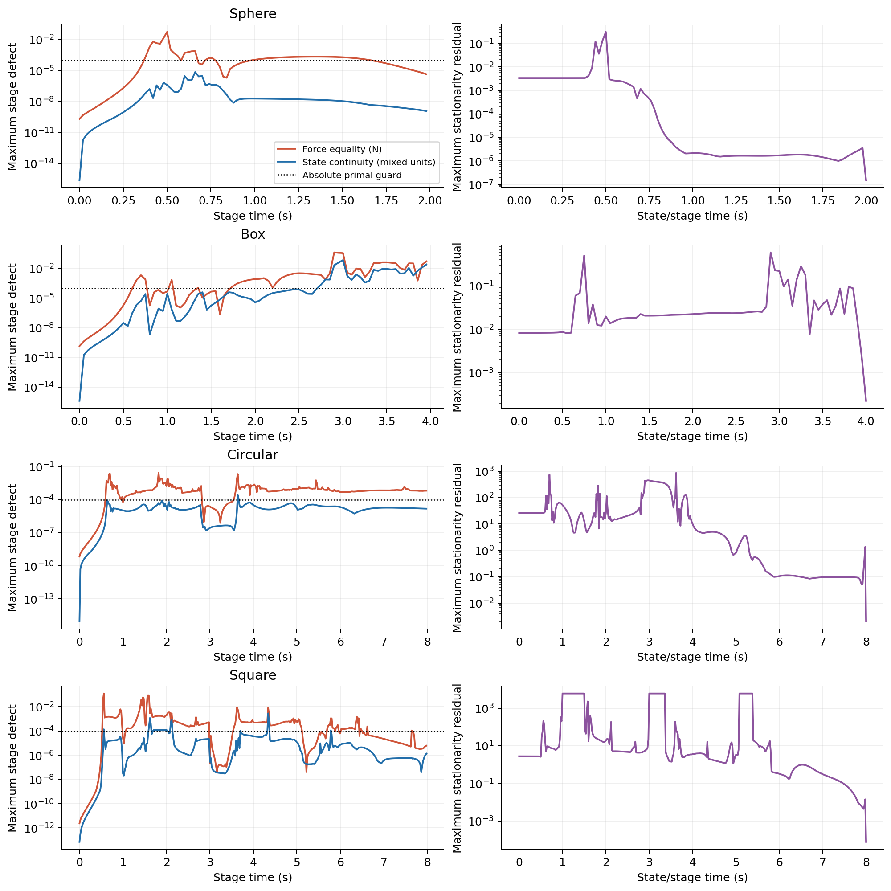
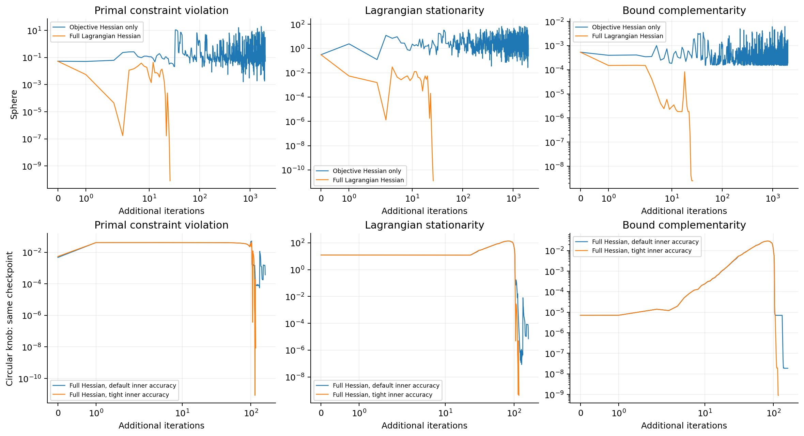
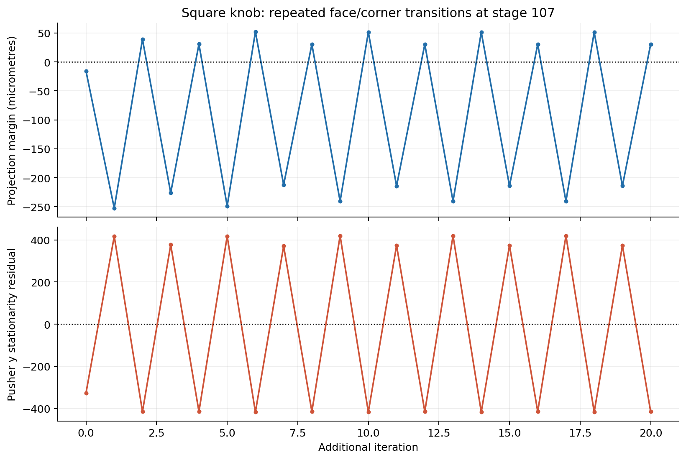

**Why the moving trajectories do not satisfy the NLP convergence tests after 500 iterations**

Follow-up to the [contact-lifting investigation](../REPORT.md), using the same repository revision and environment. The analysis reconstructs KKT residuals from the saved primal and dual solutions, locates the offending stages, checks the contact Jacobians against finite differences, and resumes the moving trajectories with different Hessian and inner-solver settings. All changes are confined to diagnostic scripts and report artifacts.

The later [finger release/recontact report](../../fingers_contact_release/REPORT.md) applies these findings to FingersSphere2d, isolates an additional capsule projection transition, and tests consistent ordinary multiple shooting without contact-force barriers or a guiding cost.

**The solver is rejecting substantial feasibility, stationarity, and bound-complementarity errors.** A small terminal goal error is not its convergence criterion. For these tasks the goal is a soft quadratic cost, so a feasible stationary trajectory can retain some goal error; conversely, an apparently successful push can violate the dynamics or contact law. Replays are useful validation, but are not part of the interior-point stopping test either.

For the four default IPOPT moving trajectories, the residuals at iteration 500 are:

| Task | State-continuity defect | Contact-force equality defect, N | Lagrangian stationarity, maximum | Bound-complementarity product, maximum | Barrier parameter `μ` |
|---|---:|---:|---:|---:|---:|
| PushSphere2d | `6.915e-6` | `0.053504` | `0.309019` | `5.352e-4` | `1.504e-4` |
| PushBox2d | `0.070136` | `0.418502` | `0.591468` | `0.003638` | `0.002828` |
| PushCircularKnob | `2.921e-4` | `0.027193` | `856.703` | `0.175467` | `0.1` |
| PushSquareKnob | `0.002846` | `0.123794` | `6039.432` | `0.090653` | `0.02` |

All four satisfy their supplied variable bounds at the saved iteration. The first column is a raw maximum over state components with their respective physical units, including angular velocity; it is not a single position error. Stationarity is likewise a maximum over differently scaled decision coordinates. The table uses reconstructed, **unscaled** residuals, including the solver's default relaxed bounds for complementarity. Individual vectors and the largest offending components are saved under [data](data).

**The tests are KKT tests, not a check that the objective has stopped changing.** Let `z` collect states, actuator commands, and contact forces; let `c(z)=0` collect initial-state, dynamics, and force-consistency equations. Write equality multipliers as `ν` and lower/upper bound multipliers as `ηᴸ,ηᵁ`. For these default pyramidal tasks there are no additional nonlinear cone inequalities. The relevant equations are

$$
r_p=c(z),\qquad
r_d=\nabla J(z)+J_c(z)^T\nu-\eta^L+\eta^U,
$$

$$
r_{c,L}=(z-l)\odot\eta^L,\qquad
r_{c,U}=(u-z)\odot\eta^U.
$$

Bounds and multiplier signs must also be feasible. At the final NLP solution the complementarity products approach zero. During a barrier subproblem the targets are `μ`, so the perturbed residuals are the products **minus `μ`**.

This complementarity is between an NLP bound slack and its **optimization multiplier**. It is not the physical product of contact force and geometric gap. The smoothed Hunt–Crossley contact law is enforced by force equalities here; this is not an unsmoothed contact-complementarity NLP.

IPOPT's default desired tests include scaled overall NLP error below `1e-8`, unscaled constraint violation below `1e-4`, unscaled dual infeasibility below `1`, and unscaled complementarity below `1e-4`. The relaxed acceptable termination still requires constraint violation below `0.01` and an acceptable overall error over successive iterations. See the official [termination options](https://www.coin-or.org/Ipopt/OPTIONS.html#OPT_tol). Every force-defect entry above exceeds even `0.01`. Every complementarity entry exceeds the desired absolute guard. Sphere and box pass the loose absolute dual guard of `1`, but their remaining stationarity still prevents the much stricter overall optimality test. The knobs fail that dual guard as well.

The console's `inf_du` and the overall scaled NLP error should not be conflated with raw stationarity; the former includes the solver's internal scaling and slack formulation. See [IPOPT output definitions](https://www.coin-or.org/Ipopt/OUTPUT.html). In the resumed experiments, the callback's constraint norm and the raw norm can also differ because scaling is recomputed at the warm start. The tables here use explicit unscaled evaluations or `get_current_violations(scaled=False)` rather than treating every callback number as an unscaled residual.

**The force defects have a concrete mechanical meaning.** The two stage equalities are

$$
x_{k+1}-f_2(x_k,u_k,\lambda_k)=0,
\qquad\lambda_k-F_\kappa(x_k,u_k)=0.
$$

The first lets independently chosen lifted forces drive the planned state transition. The second requires those same forces to agree with the contact solver. If only the first is nearly satisfied, the optimizer is still using forces that the constitutive law would not produce.

At sphere stage 25, time 0.50 s, the lifted force is `0.062257` N but the forward contact force is `0.115761` N. Their difference, `-0.053504` N, is the largest primal defect. The geometric gap is 5.44 mm, with an approaching predicted contact velocity: the implicit contact law responds to predicted gap, not only current overlap. At box stage 58, time 2.90 s, the lifted force is `0.594798` N versus `0.176297` N from the forward law, a defect of `+0.418502` N.

| Task | Largest force-defect stage | Time | Force equations exceeding `1e-4` |
|---|---:|---:|---:|
| Sphere | 25 | 0.50 s | 50 / 100 |
| Box | 58 | 2.90 s | 50 / 80 |
| Circular knob | 91, edge 2 | 1.82 s | 1268 / 1600 |
| Square knob | 28, edge 0 | 0.56 s | 700 / 1600 |

These are not single anomalous floating-point entries. A large fraction of the force equalities remain inaccurate. The largest continuity defect is in object `v_y` at sphere stage 33, object angular velocity at box stage 60, and hinge angular velocity at knob stages 182 and 217. Sphere dynamics are relatively accurate; box and knob state continuity still needs work too.



**Dual infeasibility also has identifiable components.** In the sphere, the largest stationarity residual is pusher `x` at stage 25: `0.309019`, despite zero direct pusher-position cost. The equality-multiplier gradient contributes `0.308891`, and the small bound terms do not cancel it. In the box, object `x` at stage 58 has residual `-0.591468`: the objective derivative is `+0.356156`, while equality terms contribute `-0.947825`.

The circular knob's maximum is pusher `y` at stage 181, with residual `856.703`. In the square knob, a force variable at stage 74 is worse: equality-gradient terms of `2,012,377.933` oppose a lower-bound multiplier of `2,006,338.501`, leaving `6039.432`. Its primal force is nearly at its lower bound. This illustrates the difficult multiplier scaling produced by tiny force slacks. Relative cancellation that looks substantial is still far from satisfying an absolute KKT equation.

The largest bound-complementarity product is a contact-force lower bound at sphere stage 24 (`5.352e-4`), an actuator-command lower bound at box stage 60 (`0.003638`), a contact-force lower bound at circular stage 182 (`0.175467`), and an actuator-command lower bound at square stage 80 (`0.090653`). Thus complementarity failure is not confined to the artificial contact-force bounds.

**The barrier parameter has stopped decreasing because the current subproblem remains insufficiently solved.** For all four baseline runs, `μ` is unchanged throughout the final 100 iterations. Over that window the sphere's primal defect ranges from `0.00813` to `9.76` and its dual infeasibility from `0.121` to `48.9`, while its objective stays between `6.3815` and `6.4126`. The box and knobs show similar residual oscillation rather than convergence of the KKT equations. An almost constant objective is therefore misleading.

In IPPAS this logic is directly visible in [ip_mu_update.py](/home/wei-chen/mujodico/mujodico/trajopt/_src/ippas/ip_mu_update.py:30): `μ` decreases only when the scaled perturbed KKT error is below `10μ`. Final NLP convergence is checked separately in [ip_convergence_check.py](/home/wei-chen/mujodico/mujodico/trajopt/_src/ippas/ip_convergence_check.py:29). The saved sphere IPPAS run has primal error `0.130900`, dual error `2.944706`, complementarity `7.213e-4`, and scaled NLP error `2.944706`. The circular run has primal error `0.060061`, raw dual error `2021.093`, complementarity `0.144307`, and scaled NLP error `15.9982`. These are far above its `1e-8` success and `1e-6` acceptable-error targets, and both exceed the separate `1e-4` primal guard.

**One confirmed cause is the default Hessian approximation.** The adapters default to `gauss_newton=True`. In this implementation that retains objective curvature and omits the equality/inequality contributions to the Lagrangian Hessian:

$$
H_{\rm default}=\nabla^2 J,\qquad
H_{\rm full}=\nabla^2 J+\sum_i\nu_i\nabla^2 c_i.
$$

IPOPT still adds its bound/slack curvature. Calling its option `hessian_approximation=exact` does not restore missing terms if the adapter supplies only the objective Hessian; the transcription's `gauss_newton` flag must be changed. See [the actual Hessian construction](/home/wei-chen/mujodico/mujodico/trajopt/_src/stagewise_nlp_model.py:343).

This approximation can be helpful for discovering a contact sequence, but does not provide the local Newton model of the constrained optimum. The reciprocal contact tail has large curvature near predicted contact; contact normals and moment arms add geometric curvature. Force-equality multipliers weight those terms. Omitting them can generate steps that repeatedly correct a linearized force equality and then violate its nonlinear value, or fail to reduce stationarity while the objective barely changes.

The sphere gives a controlled demonstration. Starting from its saved moving iterate and multipliers at iteration 500:

| Continuation | Additional iterations | Maximum force-equality defect | Maximum unscaled stationarity | Outcome |
|---|---:|---:|---:|---|
| Same default approximation | 2000 | `0.066877` N | `1.825709` | Still reaches iteration limit |
| Full Lagrangian Hessian | 26 | `8.020e-11` N | `1.281e-11` | IPOPT success |
| Limited-memory BFGS | 500 | `2.341e-5` N | `0.034641` | Still reaches iteration limit |

The full-Hessian run has state-continuity defect `1.11e-16` and maximum bound-complementarity product `2.506e-9`. Its planned object error is 2.99 mm, demonstrating that a nonzero goal error can coexist with full NLP convergence. This is the successful pushing basin, unlike the earlier experiment that enabled full curvature from the original initialization and converged to the no-push local minimum. The timing of the switch matters.

**A second confirmed cause is inconsistency between finite inner solves and their implicit derivatives.** SAP's custom JVP applies the implicit-function theorem to the root of the inner contact optimality equations. The forward value, however, comes from a finite iterative solve. The default tasks allow only 20 iterations with velocity tolerance `1e-5`; the inner line-search tolerance is also coarse. A small velocity correction does not ensure that the computed force sensitivities accurately match the derivative of that approximate forward evaluation.

At the worst force-defect stage of each saved trajectory, central finite differences with perturbation `1e-8` give the following maximum relative row discrepancies for the contact-force Jacobian. Rows are normalized by `max(1, row norm)`; the comparison excludes the identity derivative with respect to the lifted force.

| Task | Default inner solve | Tight inner solve: 100 iterations, tolerances `1e-12` |
|---|---:|---:|
| Sphere | `4.070e-4` | `9.189e-10` |
| Box | `1.896e-3` | `2.640e-9` |
| Circular knob | `0.37718` | `3.430e-8` |
| Square knob | `9.470e-4` | `1.162e-9` |

For example, a circular-knob force-equation derivative with respect to pusher `y` is `-106.454` by the supplied implicit Jacobian but `-66.621` by finite differences of the default forward evaluation. The discrepancy persists for perturbations of `1e-6` and `1e-8`, then largely disappears with tighter inner solves. This is a direct derivative-consistency check, not a conclusion inferred from failed optimization alone.

Across the fixed saved trajectories, the maximum remaining inner Newton velocity correction is roughly `2.5e-6` with defaults and `2.5e-13` with the tight settings. Tightening changes the forward forces by up to `0.00915` N for sphere, `0.00113` N for box, `0.00484` N for circle, and `0.00334` N for square. The largest outer force defects remain approximately `0.05348`, `0.41858`, `0.02719`, and `0.12374` N under the tighter evaluation. Thus inner inaccuracy does not simply explain away the primal violations; it also impairs the derivatives needed to eliminate them.

The circular-knob continuation separates these issues. Full-Hessian polishing with default inner accuracy improves the original moving iterate but still fails after 500 additional iterations. From that same checkpoint, another 500 iterations with default inner accuracy also fails. Changing the inner solve to 100 iterations with both tolerances `1e-12`, while retaining full curvature, converges in 118 additional iterations. The final force defect is `8.661e-9` N, state-continuity defect `1.170e-12`, stationarity `4.268e-10`, and maximum bound-complementarity product about `9.093e-10`. The final planned hinge error is `1.508e-8` rad. These are actual KKT improvements, rather than a looser stopping tolerance.

The inner-accuracy change improves the numerical force evaluator as well as its derivative consistency. It is a more accurate realization of the same constitutive model, rather than a proof that convergence with the approximate default evaluator is impossible. The distinction is visible in [the inner stopping test](/home/wei-chen/mujodico/mujodico/mjx/_src/solver_sap.py:844) and [the implicit JVP](/home/wei-chen/mujodico/mujodico/mjx/_src/solver_sap.py:891).



**These two changes do not completely explain the rectangular-object cases.** After 500 full-Hessian polishing iterations, the box still has force defect `0.04425` N and stationarity `4.6735`; the square knob still has force defect `0.001521` N and stationarity `1985.98`. Another 500 full-Hessian iterations with tight inner solves leaves:

| Task | Force defect | State-continuity defect | Stationarity | Bound complementarity |
|---|---:|---:|---:|---:|
| Box | `0.07610` N | `0.02153` | `0.88930` | `0.001845` |
| Square knob | `2.573e-5` N | `7.822e-6` | `3959.09` | `0.003494` |

The square knob has become feasible under the separate `1e-4` absolute primal guard, but is still very far from stationarity and complementarity convergence. Its objective and residuals cycle through a repeated pattern. The largest dual residual now belongs to contact edge 1 at stage 180, whose force is `1.725e-7` N. Its largest state-coordinate residual is pusher `y` at stage 107, `-326.648`.

Local derivative checks put limits on the explanation. At that square state, one-sided Lagrangian differences agree with the supplied gradient for sufficiently small perturbations, and selected full Hessian columns agree with finite differences of the gradient at relative errors below `3e-8`. The current point is nevertheless only 15.91 micrometres from a sphere-box closest-feature boundary. A 100-micrometre perturbation of pusher `y` crosses that boundary and changes the curvature regime sharply; the corresponding Hessian-vector comparison differs by a relative factor about `8.25`. The same test at one micrometre has relative discrepancy `2.75e-8`. Thus a locally accurate Hessian need not model the larger steps across geometric features.

A further 20-iteration continuation records the actual feature crossings. After a short transient, the signed projection margin repeatedly alternates between approximately `-240`/`-214` micrometres on the face side and `+30.5`/`+51.3` micrometres on the corner side. The corresponding pusher-`y` stationarity residual alternates between about `+374`/`+420` and `-415`/`-417`. This is a repeatable cycling mode, rather than slow monotone convergence. Both geometry and multipliers change along these iterations.

Holding the multipliers fixed and moving exactly to the projection boundary gives a useful qualification: the two limiting gradients in this check approach the same value, about `-328.253`. Therefore the measured cycle must not be described simply as a demonstrated finite jump in the scalar Lagrangian gradient. The evidence establishes repeated feature crossings and poor larger-step modeling, with accurate small-step derivatives; it does not isolate every contribution of geometry, multiplier updates, and filter acceptance to that cycle.



The remaining box derivative checks likewise agree locally with finite differences, while substantial feasibility and stationarity residuals remain. There is no evidence here that an incorrect local box gradient alone accounts for the failure. Nonconvex geometry, sharp changes of closest feature, force-bound conditioning, and globalization remain relevant limitations; their individual causal contributions to the box's stagnation have not been fully isolated. The successful sphere/circle polishing should not be presented as a universal fix for all four tasks.

**These results support a staged finishing strategy, with limits.** Use the force-barrier formulation and robust curvature approximation to discover the useful contact sequence; then use the full Lagrangian Hessian and contact solves accurate enough for the requested outer KKT tolerance. The successful sphere and circular continuations establish this strategy for those saved trajectories. They do not establish a universal switching rule or guarantee convergence from the original initialization. An automatic switching policy has not been implemented.

The zero-smoothing AD singularity and elliptic-cone inconsistency identified in the earlier report do not account for these particular default failures: all four runs here have positive smoothing and pyramidal or frictionless contact. Likewise, the discontinuity between positive and zero smoothing affects model comparison and execution, but does not by itself explain stagnation of an NLP with fixed positive smoothing.

The strongest practical fixes suggested by the evidence are to expose the Hessian choice clearly, tighten or adapt inner accuracy during the finishing phase, and log all three KKT residuals separately. Using a force-consistency or inner optimality-residual accuracy target would be better motivated than a fixed velocity tolerance independent of the outer tolerance. Another formulation worth testing is to enforce the constitutive contact law directly using the decision next velocity, instead of equating lifted forces to the output of a separately terminated inner solve. That alternative is not evaluated here.

**Reproduction.** Use the same CPU/x64 environment setup as in the original report. The main diagnostics are

```bash
python reports/lifted_contact_investigation/convergence_diagnostics.py
python reports/lifted_contact_investigation/contact_accuracy.py

python reports/lifted_contact_investigation/polish_convergence.py \
  --source sphere_baseline --mode gn --iterations 2000
python reports/lifted_contact_investigation/polish_convergence.py \
  --source sphere_baseline --mode exact
python reports/lifted_contact_investigation/polish_convergence.py \
  --source circular_baseline --mode exact
python reports/lifted_contact_investigation/polish_convergence.py \
  --source circular_baseline --checkpoint circular_baseline_polish_exact \
  --mode exact --inner-tolerance 1e-12 --inner-iterations 100 \
  --label circular_polish_tight
```

Polishing restores the saved primal point and multipliers, uses `warm_start_init_point=yes`, starts at the checkpoint's barrier parameter, and records the actual IPOPT violation vectors in each callback. Inner-accuracy changes keep the geometry, smoothing parameter, cost, horizon, and bound conventions fixed. The contact derivatives use the same implicit differentiation implementation; only its underlying root solve is made more accurate.

The baseline table is also available as [baseline_residuals.csv](baseline_residuals.csv), and the polishing runs as [polishing_results.csv](polishing_results.csv). Run `analyze_convergence.py` to rebuild those tables and figures. `probe_stationarity.py --source square_baseline --checkpoint square_polish_tight --check-hessian` reproduces the local gradient, geometry, and curvature checks.

To reproduce the feature trace after the square polishing checkpoint has been generated:

```bash
python reports/lifted_contact_investigation/polish_convergence.py \
  --source square_baseline --checkpoint square_polish_tight --mode exact \
  --inner-tolerance 1e-12 --inner-iterations 100 --iterations 20 \
  --trace-stage 107 --label square_feature_trace
```
